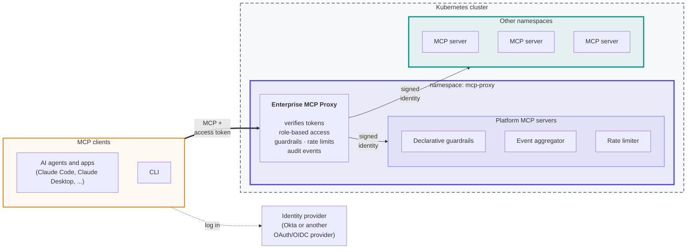
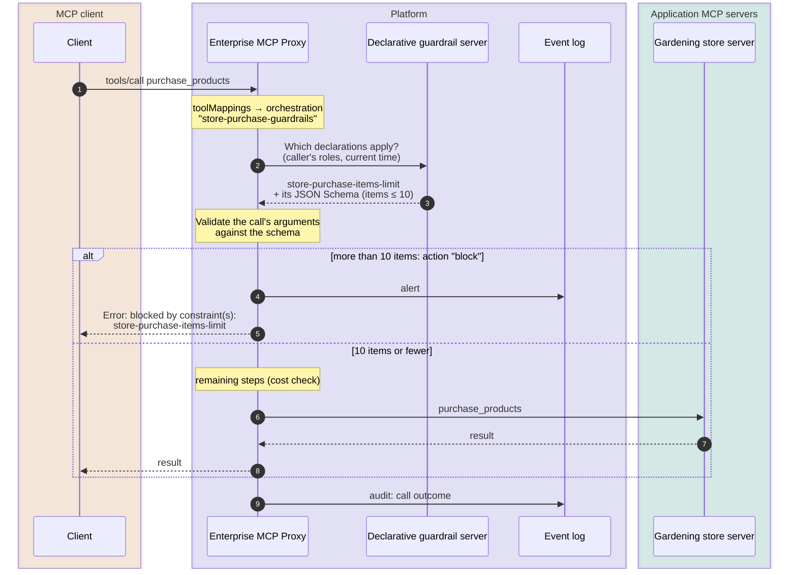

#  Enterprise MCP Proxy
An enterprise-grade MCP gateway: a reverse proxy that federates many MCP servers behind a single endpoint and adds the services enterprises need for AI clients. It runs on Kubernetes.

**Key capabilities**
- Dynamic discovery of backend MCP servers
- Layered, role-based security
- Declarative guardrails and constraints
- Event based observability and logging
- AI-powered tools
- Scalability and rate limiting
- Live, dynamic configuration

**Built for AI agents.** Every part of the platform is itself an MCP tool: configuration, events and statistics, tool discovery and prompts. An AI agent can operate and monitor the gateway the same way it uses any other tool, under the same role-based access control as a person.

**Modular and extensible.** The gateway's services aren't hard-coded features. Guardrails, event logging, rate limiting and AI assistance are ordinary MCP servers running next to the proxy, discovered and called like any other. Each one can be replaced, scaled or extended independently. A new service is added by deploying another MCP server, without changing the proxy, and any server, including your own, can contribute checks that run around tool calls. See [Platform Servers and Tools](#platform-servers-and-tools).

**Written in Go on the official MCP Go SDK.** Built on [`github.com/modelcontextprotocol/go-sdk`](https://github.com/modelcontextprotocol/go-sdk) v1.8.0, it supports MCP spec version 2026-07-28 (the latest) and negotiates down to 2025-11-25, 2025-06-18, 2025-03-26 and 2024-11-05 for older clients and servers.

**Comprehensive demo included.** The Gardening Online Store demo provides a set of backend MCP servers, a CLI and seed data that exercise the gateway's features end to end.


## Contents
1. [Quick Start](#quick-start)
2. [Why Enterprise MCP Proxy?](#why-enterprise-mcp-proxy)
3. [Architecture](#architecture)
4. [Development and Deployment](#development-and-deployment)
5. [Authentication and Authorization](#authentication-and-authorization)
6. [Dynamic Discovery](#dynamic-discovery)
7. [Declarative Guardrails and Constraints](#declarative-guardrails-and-constraints)
8. [Task Oriented Tool Discovery](#task-oriented-tool-discovery)
9. [Platform Servers and Tools](#platform-servers-and-tools)
10. [AI Powered Tools](#ai-powered-tools)
11. [Dynamic Configuration](#dynamic-configuration)
12. [Event Based Observability](#event-based-observability)
13. [Rate Limiting](#rate-limiting)
14. [AI Applications](#ai-applications)
15. [CLI](#cli)
16. [The Gardening Online Store Demo](#the-gardening-online-store-demo)
17. [Scalability](#scalability)
18. [MCP Client Limitations](#mcp-client-limitations)
19. [MCP Server Requirements and Limitations](#mcp-server-requirements-and-limitations)
20. [Roadmap](#roadmap)

## Quick Start
Deploy a published release to a local Kubernetes cluster. No Go toolchain or source build is needed. To build from source, see [Development and Deployment](#development-and-deployment).

**Prerequisites**
- A local Kubernetes cluster with `kubectl` pointing at it, e.g. [Colima](https://github.com/abiosoft/colima) with k3s on macOS:
  ```sh
  colima start --kubernetes --k3s-arg=--disable=traefik
  ```
- Docker and `python3`
- A GitHub personal access token with the `read:packages` scope, saved to a file (e.g. `github-token.txt`). It's used to pull the release images from GHCR.

**1. Download the deploy bundle** for your platform (`darwin-arm64` or `linux-arm64`) from the project's GitHub Releases page and extract it:
```sh
VERSION=v0.8.0
tar xzf deploy-bundle-$VERSION-darwin-arm64.tar.gz
cd deploy-bundle-$VERSION-darwin-arm64
```

**2. Deploy** the proxy, the platform servers, the demo authorization server and the Gardening Online Store demo, with the demo's configuration:
```sh
./scripts/deploy.sh --release $VERSION --github-owner <owner> \
  --github-token-file /path/to/github-token.txt --deploy-all \
  --config go-gardening-demo/gardening-demo.cfg
```
Replace `<owner>` with the GitHub account or organization that published the release. Keep passing the same `--config` on later deploys (see [Which configuration the demo runs with](#the-data)). The AI-powered tools are skipped unless you also pass `--ai-api-key-file` and `--ai-model`.

**3. Try it.** The proxy is now at `http://localhost/mcp`. List the tools the demo `admin` user can see:
```sh
./scripts/cli.sh -username admin -password admin list-tools
```

## Why Enterprise MCP Proxy?
AI agents don't just answer questions. They act: they call tools, change records and trigger workflows, often on their own and on behalf of a user. The Model Context Protocol (MCP) makes it easy to connect agents to tools. But it leaves the controls an enterprise needs to every client and server individually: who may do what, within which limits, and with what record.

Permissions granted to an agent once, up front, aren't enough when the agent decides at run time what to call. Enterprise MCP Proxy puts those controls in one place and applies them to every call, as it happens:

| The challenge | How Enterprise MCP Proxy addresses it |
|---|---|
| **Agents act with more authority than the task needs.** OWASP ranks this among the top risks of AI applications ([Excessive Agency][owasp-llm06]; [Identity & Privilege Abuse][owasp-asi]). | An agent acting for a user gets only that user's permissions. Role rules decide which tools, prompts and resources each caller can see and call. A call relayed on a user's behalf never gets more authority than the user had. |
| **Credentials leak along the chain.** Forwarding a client's token to downstream servers ("token passthrough") is [explicitly forbidden by the MCP specification][mcp-passthrough]. | The proxy verifies the client's token against your identity provider and never forwards it. Each backend server receives a short-lived identity signed by the proxy instead. |
| **Permissions alone can't judge a specific call.** Whether a refund or an update is acceptable depends on its arguments, on who is asking and on when ([Tool Misuse & Exploitation][owasp-asi]). | Declarative guardrails check each call before it reaches a server, and each result before it reaches the agent. Constraints apply to arguments and results, scoped by role and time window, and can block, alert or log. |
| **No single record of what agents did.** | Every rejected, completed or failed call is published as an event to a central event log, with alerts and end-to-end traceability. |
| **Runaway or abusive usage.** | Rate limits per tool and per role keep usage fair and costs predictable. |
| **Tool sprawl.** Every client is wired to every server, each configured separately. | All clients use one endpoint. New servers are discovered automatically and governed by the same policies. |

The result is the pattern that industry guidance points to: one control point that decides on every agent action, with identity, policy and audit applied consistently, instead of being re-implemented in every client and server.

[owasp-llm06]: https://genai.owasp.org/llmrisk/llm062025-excessive-agency/
[owasp-asi]: https://genai.owasp.org/resource/owasp-top-10-for-agentic-applications-for-2026/
[mcp-passthrough]: https://modelcontextprotocol.io/specification/latest/basic/security_best_practices

## Architecture


- **One endpoint.** Clients connect only to the proxy, which presents the tools, prompts and resources of every MCP server behind it as a single MCP server. The proxy finds those servers itself (see [Dynamic Discovery](#dynamic-discovery)).
- **Security lives in the proxy.**
  - Clients log in through your identity provider and send an access token, which the proxy verifies.
  - Every request then passes through role-based access rules, guardrails and rate limits.
  - A client's token is never passed on. Backend servers instead receive a short-lived identity signed by the proxy.
  - Kubernetes network policies ensure the backends can be reached only through the proxy.
- **Stateless.** The proxy serves clients in stateless mode, so any replica can handle any request. Scale it out without sticky sessions.
- **Namespaces.** The proxy and its platform MCP servers run in the `mcp-proxy` namespace. Other MCP servers, such as the Gardening Online Store demo (`gardening-demo`), can run in other namespaces, as long as the namespace is listed in the `discovery` section's `k8sNamespaces`.
- **Extensible by design.** The proxy's own services, such as guardrails, event aggregation, rate limiting and AI-powered tools, are ordinary MCP servers. They can be added, replaced or modified without changing the proxy.
- **Triggered tools.** Guardrails and other checks are orchestrated as tools that the proxy runs before a call reaches a server and before its result reaches the client. Clients never see or call them directly (see [Declarative Guardrails and Constraints](#declarative-guardrails-and-constraints)).
## Development and Deployment
The essentials for working on the proxy itself. The **[Development and Deployment Guide](docs/development-and-deployment.md)** covers every step in detail.

**Prerequisites**
- **Tools:** Go (the version in `go.mod`), Docker, `kubectl`, `python3`, and a local Kubernetes cluster. The reference setup is macOS with [Colima](https://github.com/abiosoft/colima) running k3s:
  ```sh
  colima start --cpu 2 --memory 4 --disk 40 --kubernetes --k3s-arg=--disable=traefik
  ```
- **Resources:** 2 CPUs and at least 2 GiB of memory for the cluster VM. The full stack uses about 1.2 GiB, so use 4 GiB with the AI-powered tools or for stress tests. Allow about 20 GiB of VM disk, plus 5–10 GB on the host for Go caches.
- **Configuration:** the proxy reads one JSON file, [`proxy-server.cfg`](proxy-server.cfg). Most sections are seeded into Kubernetes ConfigMaps on first start and then updated live, so editing the file later doesn't change them ([details](docs/development-and-deployment.md#4-configuration)).

**Compatibility**
- **MCP spec versions:** 2024-11-05 through 2026-07-28 (the latest), negotiated per connection, for both clients and servers.
- **MCP servers:**
  - Any server that speaks MCP over **Streamable HTTP** can sit behind the proxy.
  - In Kubernetes, label its Service `mcp.io/role=backend-mcp-server` (plus `mcp.io/path` if it isn't served at `/`). Otherwise, list it in the `discovery` section of the config.
  - Servers need no authentication of their own.
  - Stdio-only servers need an HTTP bridge in front of them.
- **MCP clients:**
  - Any client that supports **Streamable HTTP** and the **MCP authorization flow** (OAuth 2.1 with an external identity provider) can connect, for example the included CLI, Claude Code or Claude Desktop.
  - Clients that rely on automatic client registration need an identity provider that supports it. With Okta, register each client in advance.
  - Claude Desktop needs a public HTTPS URL.
- **Elicitation** (a tool asking the user for input mid-call) is passed through when both the client and the server use MCP protocol 2026-07-28.
- **Not relayed yet:** older-style server-initiated requests (sampling, and elicitation before 2026-07-28) and resource subscriptions.

See the [guide](docs/development-and-deployment.md#3-supported-mcp-servers-and-clients) for details.

**Build**
```sh
./scripts/build.sh            # all images (tag :local) and the CLIs; incremental
```

**Deploy locally**
```sh
./scripts/deploy.sh --deploy-all --config go-gardening-demo/gardening-demo.cfg   # never builds; run build.sh first
./scripts/cli.sh -username admin -password admin list-tools    # the proxy is at http://localhost/mcp
./scripts/observe-k8s.sh                                       # pod status
./scripts/cleanup-k8s-cluster.sh                               # remove everything
```
Redeploy just what you changed, e.g. `./scripts/deploy.sh --deploy-proxy`. To include the AI-powered tools, add `--ai-api-key-file <file> --ai-model <model>`.

**Release**
```sh
./scripts/build.sh --release v1.2.0 --github-token-file ./github-token.txt
```
This tags the commit, pushes all images to GitHub Container Registry and publishes per-platform deploy bundles on a GitHub Release. Deployers then need no Go and no source code (see [Quick Start](#quick-start)).

A release needs a GitHub personal access token saved in a file, e.g. `github-token.txt` at the repo root, which is git-ignored and must never be committed. Create a classic token at GitHub → Settings → Developer settings → Personal access tokens, with these scopes:
- **`write:packages`** and **`read:packages`** to push the images.
- **`repo`** to create the Release and upload the bundles.

Deploying a release only needs `read:packages`.

**Deployment**

To deploy a release on any machine with `kubectl` pointing at the target cluster (no Go or source code needed):
1. **Download** the deploy bundle for the machine you'll deploy *from* (`darwin-arm64` or `linux-arm64`, or `-amd64` for an amd64 release) from the project's GitHub Releases page.
2. **Extract** it and change into its folder:
   ```sh
   tar xzf deploy-bundle-v1.2.0-darwin-arm64.tar.gz
   cd deploy-bundle-v1.2.0-darwin-arm64
   ```
3. **Deploy** with a token file that has `read:packages`:
   ```sh
   ./scripts/deploy.sh --deploy-all --release v1.2.0 \
     --github-owner <owner> --github-token-file /path/to/github-token.txt \
     --config go-gardening-demo/gardening-demo.cfg
   ```
   `<owner>` is the GitHub account or organization that published the release.
4. **Check** the deployment:
   ```sh
   ./scripts/cli.sh -username admin -password admin list-tools
   ```

Notes on deploying:
- **CPU architectures:** images are built for the CPU architecture of the machine that runs the release. A release built on arm64 (e.g. Apple Silicon) is published as `v1.2.0`; one built on amd64 as `v1.2.0.amd64`. Deploy the variant that matches your cluster's nodes ([details](docs/development-and-deployment.md#11-cpu-architectures)).
- **Enterprise deployment:** a port-less HTTPS URL behind an nginx ingress, with Okta as the identity provider, is opt-in via `--ingress-host`. See the [enterprise deployment guide](docs/enterprise-deployment/enterprise-deployment.md).

**Testing**

Unit and integration tests:
```sh
go test ./...                              # no cluster or external services needed
go test ./proxyserver -run TestName -v     # a single test
```
The proxy's integration tests use fixed local ports (8081–8096, 8113–8115, 8120), so keep those ports free while they run.

Stress testing: `./stress-test/run.sh --client-count 1 --calls-per-second 1 --duration 2` redeploys the stack and runs concurrent clients against the gardening demo, then checks pod health and logs. See [`stress-test/README.md`](stress-test/README.md).

## Authentication and Authorization
The proxy never logs users in itself. Users log in at an **identity provider**, and the client sends the resulting access token (a signed JWT) with every request.
- **Verification.** The proxy checks the token's signature against the provider's published keys, along with its expiry, issuer and audience.
- **Roles.** The proxy reads the caller's roles from a configurable claim, such as Okta's `groups`. Role-based access rules then decide which tools, prompts and resources each caller can see and call. A separate, fixed administrator role controls the proxy's own admin tools.
- **Backends.** Backend servers never receive the client's token. They get a short-lived identity signed by the proxy instead, and network policies ensure they can be reached only through the proxy.

Clients discover where to log in automatically, as the MCP authorization specification defines: an unauthenticated request gets `401` with a pointer to metadata naming the identity provider.

**Development and demo: a small built-in authorization server.** Production deployments are expected to use a leading identity provider such as Okta, Microsoft Entra ID or Auth0. For development and demos, a small footprint matters more, so the project ships `demo-authorization-server`, a minimal OAuth 2.1 server.
- **Small footprint:** a few MB of memory, instant startup, and no external accounts, unlike full products such as Keycloak.
- **Standard behavior:** it issues standard tokens, so moving to a real provider is a configuration change, not a code change.
- **Demo-grade users:** each demo user's password is the username (`admin`/`admin` is the administrator).
- **Deploy it** with `--deploy-auth-server`, or as part of `--deploy-all`.

```sh
# Log in without a browser (demo server only)
./scripts/cli.sh -username admin -password admin list-tools

# Log in through the browser: the CLI prints a login URL to open
./scripts/cli.sh list-tools

# Add a demo user with roles, then use it
echo '[{"username":"alice","roles":["finance"]}]' > alice.json
./demo-authorization-server/scripts/manage-users.sh add alice.json
./scripts/cli.sh -username alice -password alice list-tools
```

**Production:** the [enterprise deployment guide](docs/enterprise-deployment/enterprise-deployment.md) covers deploying with Okta behind an nginx ingress, at a port-less HTTPS URL, step by step. **Full details** are in [Authentication and Authorization](docs/authentication-and-authorization.md):
- the token checks;
- login discovery;
- access-rule syntax and live updates;
- the administrator role;
- backend identity;
- network isolation;
- using other identity providers.

## Dynamic Discovery
go-proxy finds backend MCP servers by itself. Adding or removing a server needs no proxy configuration change and no restart.

In Kubernetes, go-proxy checks every few seconds for Services labeled `mcp.io/role=backend-mcp-server` in the namespaces listed in the `discovery` section's `k8sNamespaces` (`mcp-proxy` and `gardening-demo` by default). Services in any other namespace are never discovered. Each match becomes a backend server:
- **Name:** the Service name. Its tools and prompts are exposed as `<server>.<name>`, and its resources as `<server>:<uri>`.
- **Address:** the Service's cluster address and first port. The `mcp.io/server-name`, `mcp.io/port` and `mcp.io/path` annotations override the name, port and path. Credentials the gateway presents to it are assigned in the gateway's own config (see [Backend credentials](#backend-credentials)).
- **Removal:** when a Service disappears, go-proxy drops its tools and closes its connections.

Who may call a discovered server's tools is still decided by the role rules (see [Authentication and Authorization](#authentication-and-authorization)).

Outside Kubernetes, discovery can also use a static list of servers, or scan local processes for `--mcpServerName`/`--mcpServerUrl` flags. The `discovery` section of `proxy-server.cfg` picks the mode and polling intervals.

**Try it:** [`examples/discovery`](examples/discovery/README.md) deploys a one-tool hello-world server with three scripts: deploy it, wait until it's discovered, and call its tool.

## Declarative Guardrails and Constraints
A **constraint** is a rule about what a tool call may contain, or what its result may contain, written as configuration rather than code. Access rules decide *whether* a role may use a tool at all. Constraints judge *each individual call*: for example, "a purchase may not cost more than $1,000", or "a complaint must say what happened".

Constraints are written as **declarations**. Each declaration says:
- **What to check.** The constraint can take three forms:
  - **A JSON Schema** that the call's arguments (or its result) must match.
  - **A plain-English sentence** that an LLM judges the call against. This needs the [AI-powered tools](#ai-powered-tools) server.
  - **The name of a business validation tool** on the target server, for checks that need that server's own data.
  - An empty constraint means "always triggers", which is useful for pure time-based alerts.
- **Who it applies to** (`roleExpression`): a boolean expression over the caller's roles, using `&` (and), `|` (or), `!` (not) and parentheses. `_any_role` matches everyone. For example, `"!admin & !customer-support-manager"` applies to everyone except those two roles.
- **When it applies.** This part is optional:
  - `effectiveDate` limits the declaration to a date range.
  - `effectiveTime` limits it to days of the week and hours.
  - `timezone` sets the time zone (UTC by default).
- **What happens when it's violated** (`actions`): any combination of `block` (refuse the call), `alert` (publish an alert event) and `log`.

Declarations run as **orchestrations**: ordered lists of checks that the proxy runs around a tool call. An orchestration has up to three phases:
- **`callAuthorization`:** steps that run before the call reaches the server.
- **`resultAuthorization`:** steps that run before the result reaches the client. They cover tool results (including a tool's request for user input), not prompts or resources, so don't expose data a result check protects through a prompt or resource too.
- **`toolCallAudit`:** events that are published afterwards (see [Event Based Observability](#event-based-observability)).

Within a phase, steps run in order, and the first one that refuses stops the call. **`toolMappings`** then attach orchestrations to tools by name pattern. The mappings are checked in order and the first match wins, so a final `"*"` mapping acts as the catch-all. Guardrails fail closed. If a declaration can't be checked (its validator is unreachable or errors, its constraint is invalid, or the data is too large for the AI validator), it counts as triggered: a `block` declaration refuses the call, and an `alert` declaration raises an alert saying it couldn't be checked. If the guardrail server itself can't be reached, the call is refused.

All of this lives in the `declarativeGuardrails` and `governanceOrchestration` config sections, and can be changed live with the CLI (`export-declarative-guardrails` / `update-declarative-guardrails`, `export-orchestration` / `update-orchestration`).

**How a constraint is checked at run time.** This example is from the Gardening Online Store demo application. It uses the `store-purchase-items-limit` declaration in the demo's config, [`go-gardening-demo/gardening-demo.cfg`](go-gardening-demo/gardening-demo.cfg), which is explained in detail below:



Here the proxy checks the JSON Schema itself, with no extra call. The other two kinds of constraint add one call at the "Validate" point. A plain-English constraint is sent to the AI-powered tools server to judge. A business validation tool is called on the target server, which checks the call with its own data.

### Example: guardrails on store purchases
From [`go-gardening-demo/gardening-demo.cfg`](go-gardening-demo/gardening-demo.cfg). Three declarations protect `purchase_products`: one is a plain JSON Schema limit, and two use business logic.

**1. The declarations.** A **schema limit** on how many line items one purchase may have:
```json
{ "name": "store-purchase-items-limit",
  "constraint": "{\"type\":\"object\",\"properties\":{\"arguments\":{\"type\":\"object\",\"properties\":{\"items\":{\"type\":\"array\",\"maxItems\":10}}}}}",
  "roleExpression": "!admin",
  "actions": ["block", "alert"] }
```
The `constraint` field is a string, so the config holds the schema as one escaped JSON string. Decoded and indented, it reads:
```json
{
  "type": "object",
  "properties": {
    "arguments": {
      "type": "object",
      "properties": {
        "items": { "type": "array", "maxItems": 10 }
      }
    }
  }
}
```
The schema describes an **allowed** call: an `items` argument with at most 10 entries. A call that doesn't match triggers the actions. The schema is nested under `arguments` because the proxy validates the whole call request, whose `arguments` hold the tool's input. `!admin` exempts administrators.

Then a soft and a hard **cost limit**:
```json
{ "name": "store-purchase-cost-warning",
  "constraint": "{\"validationTool\": \"validate_store_requests\", \"parameters\": {\"maxTotalCost\": 700}}",
  "roleExpression": "!admin",
  "actions": ["alert"] },
{ "name": "store-purchase-cost-limit",
  "constraint": "{\"validationTool\": \"validate_store_requests\", \"parameters\": {\"maxTotalCost\": 1000}}",
  "roleExpression": "!admin",
  "actions": ["block", "alert"] }
```
Decoded, each constraint names the validation tool and its parameters, here for the $700 warning:
```json
{
  "validationTool": "validate_store_requests",
  "parameters": { "maxTotalCost": 700 }
}
```
A purchase's total isn't in the request. It depends on the store's prices and active deals, which only the store server knows. So these constraints name a **business validation tool** on that server, `validate_store_requests`, with a parameter (`maxTotalCost`). That tool dry-runs the store's real pricing logic without side effects and reports whether the total would exceed the limit. The tool is hidden from clients; only the proxy's orchestration can call it.

**2. An orchestration** runs them before the purchase happens, cheapest check first:
```json
"store-purchase-guardrails": {
  "callAuthorization": [
    { "server": "proxy_utility", "tool": "request_constraints_validation",
      "parameters": "{\"declarationNames\": [\"store-purchase-items-limit\"]}" },
    { "server": "proxy_utility", "tool": "business_logic_constraints_validation",
      "parameters": "{\"declarationNames\": [\"store-purchase-cost-limit\", \"store-purchase-cost-warning\"]}" }
  ],
  "toolCallAudit": ["publish-tool-request-result"]
}
```
- **Step 1, `request_constraints_validation`:** asks the guardrail server which of the named declarations apply to this caller right now, by role and time. It validates the call's arguments against each applicable declaration's schema, and carries out the actions for any violation. It runs entirely in the proxy, so an oversized order is refused before the store server is asked to price it.
- **Step 2, `business_logic_constraints_validation`:** does the same lookup, but calls each declaration's validation tool on the target tool's own server instead of checking a schema.
- **`toolCallAudit`:** publishes the call's outcome as an event afterwards.

**3. A tool mapping** attaches the orchestration to the purchase tool:
```json
"toolMappings": [
  { "pattern": "garden-online-store.purchase_products", "orchestration": "store-purchase-guardrails" },
  ...
  { "pattern": "*", "orchestration": "catch-all" }
]
```

**The result.** For any caller except an administrator:

| Purchase | What happens |
|---|---|
| More than 10 line items | **Refused** at step 1: "blocked by constraint(s): store-purchase-items-limit". An alert is published. |
| Total of $700 or less | The purchase goes through. |
| Total over $700, up to $1,000 | It goes through, and an alert is published (`store-purchase-cost-warning`). |
| Total over $1,000 | **Refused** at step 2: "blocked by constraint(s): store-purchase-cost-limit". Both cost declarations publish an alert. |

### Example: an AI-powered guardrail on customer complaints
**1. The declaration** is plain English:
```json
{ "name": "service-call-content-required",
  "constraint": "The request's issueText argument must state when the complaint happened, what happened, and what remedy is requested.",
  "roleExpression": "!admin & !customer-support-manager",
  "actions": ["block"] }
```
No schema can tell whether free text describes a complaint properly, so the constraint is written as a sentence. An LLM, reached through the AI-powered tools server, judges each call against it. It applies to everyone except administrators and customer-support managers, and blocks a complaint that's missing the required details.

**2. The orchestration** runs two steps, in order, before the complaint is recorded:
```json
"service-call-guardrails": {
  "callAuthorization": [
    { "server": "proxy_utility", "tool": "request_constraints_validation",
      "parameters": "{\"declarationNames\": [\"weekend-service-call-alert\"]}" },
    { "server": "proxy_utility", "tool": "request_ai_constraints_validation",
      "parameters": "{\"declarationNames\": [\"service-call-content-required\"]}" }
  ],
  "toolCallAudit": ["publish-tool-request-result"]
}
```
- **Step 1** applies `weekend-service-call-alert`, a time-based declaration with an empty constraint. On Saturdays and Sundays it raises an alert for every complaint (in UTC, since no `timezone` is set). On weekdays it doesn't apply.
  ```json
  { "name": "weekend-service-call-alert", "roleExpression": "_any_role", "actions": ["alert"],
    "effectiveTime": [{ "days": ["saturday", "sunday"], "startTime": "00:00", "endTime": "23:59" }] }
  ```
- **Step 2** is the built-in `request_ai_constraints_validation` check. It sends the call and the English constraint to the LLM, and blocks the call if the LLM finds it violates the constraint.

**3. The tool mapping** attaches it to the complaint tool:
```json
{ "pattern": "garden-customer-service.add_customer_service_call", "orchestration": "service-call-guardrails" }
```

**The result.**
- **An incomplete complaint is refused.** "My order is wrong" is refused for an ordinary support agent, because it doesn't say when, what, or which remedy. "On Oct 3 my rose bushes arrived dead; I want a replacement" goes through.
- **Managers and administrators bypass the AI check.**
- **Weekend complaints also raise an alert,** whoever files them.
- **If the AI tools server isn't deployed,** the AI declarations can't be checked, so they count as triggered: this `block` declaration refuses the calls it covers. Deploy the server with `--ai-api-key-file` and `--ai-model`, or leave AI declarations out of the config.
- **AI checks can be talked into a verdict.** The request or result is shown to the model as data, kept apart from its instructions, and only an exact "ok" or "violation" answer counts. That makes text hidden in the data much less effective, not impossible. For a rule that must hold, add a deterministic check (a JSON-Schema constraint or a business validation tool) alongside the AI one. Data larger than the step's `maxInputBytes` (64 KiB by default) isn't sent to the model and counts as "couldn't be checked".

## Task Oriented Tool Discovery
An AI client normally loads the full definition of every tool it can use, including the name, description and input schema, into its context window before it starts working. Behind a gateway that federates many MCP servers, that list grows quickly; the administrator in the demo alone sees 75 tools. A large tool list has real costs:
- It uses up context the model needs for the actual task.
- It slows every request.
- It makes the model more likely to pick the wrong tool among many similar ones.

Task-oriented tool discovery lets the client start small and load only the tools a task needs, using two of the proxy's own utility tools:

| Tool | What it does |
|---|---|
| `proxy_utility.find_relevant_tools` | Takes a plain-language `task`, and returns the full definitions, input schemas included, of just the caller's tools that are relevant to it. An LLM, reached through the [AI-powered tools](#ai-powered-tools) server, does the selection. |
| `proxy_utility.call_tool` | Calls any tool by name with arguments (`tool`, `arguments`) on the caller's behalf, including a tool that isn't in the client's tool list. |

> ⚠️ **Important: `find_relevant_tools` requires the AI-powered tools server.** Deploy it with `./scripts/deploy.sh --deploy-ai --ai-api-key-file <file> --ai-model <model>`, or as part of `--deploy-all` with the same two options. Without it, `find_relevant_tools` fails. `call_tool` works either way.

**How to set it up:** narrow the tool list with the `listedTools` setting in the `discovery` config section, so clients see only the utility tools:

```json
"discovery": { "listedTools": ["proxy_utility.*"], ... }
```

`listedTools` only controls what appears in tool lists. Every tool a caller's role allows can still be found with `find_relevant_tools` and called with `call_tool`. The shipped configs grant `proxy_utility.find_relevant_tools` to every role; since each call costs an LLM request, you can grant it to fewer.

**How a client uses it:**
1. **Its tool list is short:** just the handful of `proxy_utility.*` tools.
2. **It describes the task:**
   ```json
   { "task": "Buy three rose bushes for customer cust-0002" }
   ```
   `find_relevant_tools` returns only the few tools that matter, e.g. the store's catalog and purchase tools, with their schemas.
3. **It calls the one it needs through `call_tool`:**
   ```json
   { "tool": "garden-online-store.purchase_products",
     "arguments": { "customerId": "cust-0002", "items": [{ "productId": "prod-07", "units": 3 }] } }
   ```

**Nothing is bypassed:**
- **`find_relevant_tools` only ever returns tools the caller is already allowed to use.** The LLM only proposes names, which are checked against the caller's own authorized list, so it can't add a tool.
- **`call_tool` is treated exactly like a direct call:** the same access rules, guardrails, rate limits and audit events apply to the target tool.

## Platform Servers and Tools
Enterprise MCP Proxy is built out of the same thing it serves: **MCP servers and tools**. That's the foundation of two of its defining qualities:

- **Expandable and modular.**
  - The proxy's services (guardrails, event logging, rate limiting, AI assistance) aren't hard-coded features. They're ordinary MCP servers running next to the proxy, discovered and called like any other.
  - A service can be replaced, scaled or extended independently. A new one is added by deploying another MCP server, without changing the proxy.
  - Checks that run around tool calls are just tools with a known contract, so any server, including your own application servers, can contribute one.
- **Accessible to AI agents.** Every part of the platform is reachable as an MCP tool:
  - configuring it;
  - inspecting its events and statistics;
  - finding and calling tools;
  - rendering prompts.

  An AI agent can operate and monitor the gateway with the same mechanism it already uses for everything else, under the same role-based access control as a person using the CLI.

The tools fall into five categories:

### Platform servers
Platform servers are MCP servers that implement the proxy's own services. They run in the proxy's `mcp-proxy` namespace and are discovered like any backend. They receive their configuration live from the proxy (see [Dynamic Configuration](#dynamic-configuration)). Their tools are ordinary tools, gated by the access rules; by default only administrators can use them.

| Server | Tools | Used in |
|---|---|---|
| `declarative-guardrail` | `evaluate_declarations`: which declarations apply to a caller right now, and their constraints. `get_config_version`: the guardrail config version in effect. | [Declarative Guardrails and Constraints](#declarative-guardrails-and-constraints) |
| `event-aggregator` | `list_events`: query events, filtered by type, user, role, tool and time. `get_event_stats`: event counts. `reset_events` and `load_events`: clear or load events, for tests and demos. | [Event Based Observability](#event-based-observability) |
| `rate-limiter` | `get_stats`: blocked calls and wait times per tool and role. (`check_permission` is a triggered tool; see below.) | [Rate Limiting](#rate-limiting) |

### Utility tools
Utility tools (`proxy_utility.*`) are built into the proxy itself and act on the caller's behalf. Unlike the configuration tools, they go through the normal access rules. By default every role gets `call_tool`, `get_my_id_details`, `get_prompts` and `render_prompt`.

| Tool | What it does |
|---|---|
| `find_relevant_tools` | Given a plain-language task, returns just the caller's tools relevant to it. See [Task Oriented Tool Discovery](#task-oriented-tool-discovery). |
| `call_tool` | Calls another tool by name on the caller's behalf, with the same access rules, guardrails and audit as a direct call. See [Task Oriented Tool Discovery](#task-oriented-tool-discovery). |
| `get_my_id_details` | Returns the caller's own user ID and roles, as the proxy sees them after reading the token. It's useful for an agent to understand its own permissions, and for checking a login or role mapping. |
| `get_prompts` | Returns the prompts the caller may use, across all servers. It can filter by a name pattern (`namePattern`, e.g. `"garden-online-store.*"`). |
| `render_prompt` | Renders a prompt by name with arguments, under the same access rules as a direct prompt request. Together with `get_prompts`, it gives a tools-only client (one that can call tools but not use MCP prompts directly) access to every server's prompts. |
| `list_triggered_tools` | Lists the triggered tools, which never appear in ordinary tool lists, optionally with their details (`verbose`). It's useful when writing orchestrations. Not granted to ordinary roles by default. |

### Configuration tools
Configuration tools (`_admin.*`) are built into the proxy and are restricted to the administrator role defined by `roleMapping`. The access rules can't grant them to anyone else. Each live-updatable config section has an **export** tool (the current config, with its version) and an **update** tool (replace it). An update is refused if the version no longer matches, so concurrent changes can't overwrite each other. Changes apply immediately, with no restart. These tools are used in [Dynamic Configuration](#dynamic-configuration).

| Config section | Export | Update |
|---|---|---|
| Access rules | `_admin.export_role_permissions` | `_admin.update_role_permissions` |
| Orchestration | `_admin.export_orchestration` | `_admin.update_orchestration` |
| Discovery | `_admin.export_discovery` | `_admin.update_discovery` |
| Declarative guardrails | `_admin.export_declarative_guardrails` | `_admin.update_declarative_guardrails` |
| Event dictionary | `_admin.export_event_dictionary` | `_admin.update_event_dictionary` |
| Event aggregation | `_admin.export_event_aggregation` | `_admin.update_event_aggregation` |
| Rate limiting | `_admin.export_rate_limiting` | `_admin.update_rate_limiting` |
| Log level | `_admin.export_log_level` | `_admin.update_log_level` |
| *All sections* | `_admin.export_full_config`: the whole configuration as one deployable `proxy-server.cfg` | |

### Triggered tools
Triggered tools are the checks that run **around** tool calls: before the call reaches its server, or before the result reaches the client.
- **Hidden from clients:** they never appear in tool lists, and clients can't call them. Only the proxy's orchestration runs them.
- **Marking:** a tool becomes a triggered tool through a marker in its metadata, so any MCP server can provide one alongside its ordinary tools.
- **Where they're used:** see [Declarative Guardrails and Constraints](#declarative-guardrails-and-constraints) and [Rate Limiting](#rate-limiting).

| Tool | Provided by | What it checks |
|---|---|---|
| `proxy_utility.request_constraints_validation` | The proxy | A call's arguments against JSON Schema constraints |
| `proxy_utility.result_constraints_validation` | The proxy | A call's result against JSON Schema constraints |
| `proxy_utility.request_ai_constraints_validation` | The proxy | A call's arguments against plain-English constraints, judged by an LLM |
| `proxy_utility.result_ai_constraints_validation` | The proxy | A call's result against plain-English constraints, judged by an LLM |
| `proxy_utility.business_logic_constraints_validation` | The proxy | Hands the decision to a business validation tool on the target server |
| `rate-limiter.check_permission` | `rate-limiter` | Admits or delays a call under the rate limits |
| `garden-online-store.validate_store_requests`, `garden-business-ops.validate_deal_requests`, `garden-staff-admin.validate_staff_handling` | The gardening demo's servers | Example business validation tools |

### The AI-powered tools server
The `ai-powered-tools` server is unique among the platform servers: it **needs an LLM model and an API key** (`--ai-api-key-file` and `--ai-model` at deploy time), so it's optional, and the features built on it work only when it's deployed. See [AI Powered Tools](#ai-powered-tools).

| Tool | Used by |
|---|---|
| `_filter_tool` | `proxy_utility.find_relevant_tools`: picks the tools relevant to a task |
| `ai_result_validator` | The two `*_ai_constraints_validation` triggered tools: judges plain-English constraints |

Neither is meant to be called by clients directly.

### Examples using the CLI
Most of these tools have a dedicated CLI command; any tool can also be run with `call-tool`. Log in as `admin` for the platform and configuration tools.

```sh
# Who am I, and which roles do I have?
./scripts/cli.sh -username cust-0002 -password cust-0002 call-tool -name proxy_utility.get_my_id_details

# Call a tool on my behalf
./scripts/cli.sh -username cust-0002 -password cust-0002 call-tool -name proxy_utility.call_tool \
  -args '{"tool":"garden-online-store.get_catalogue","arguments":{}}'

# List the store's prompts, then render one
./scripts/cli.sh -username admin -password admin call-tool -name proxy_utility.get_prompts \
  -args '{"namePattern":"garden-online-store.*"}'
./scripts/cli.sh -username cust-0002 -password cust-0002 call-tool -name proxy_utility.render_prompt \
  -args '{"name":"garden-online-store.product_on_sale_for_me","arguments":{"product":"rake"}}'

# Recent alerts from the store, from the event aggregator
./scripts/cli.sh -username admin -password admin list-events -type alert -tool "garden-online-store.*"

# Rate-limiting statistics for the last 30 minutes
./scripts/cli.sh -username admin -password admin call-tool -name rate-limiter.get_stats -args '{"minutes":30}'

# Export the access rules, edit them, and apply them live
./scripts/cli.sh -username admin -password admin export-role-permissions > rules.json
./scripts/cli.sh -username admin -password admin update-role-permissions -file rules.json

# Which triggered tools exist?
./scripts/cli.sh -username admin -password admin call-tool -name proxy_utility.list_triggered_tools

# Find the tools for a task (needs the AI-powered tools server)
./scripts/cli.sh -username cust-0002 -password cust-0002 find-relevant-tools -task "buy three rose bushes"
```

## AI Powered Tools
**The idea: intelligence next to the tools, not in every client.** AI-powered tools put LLM processing inside the gateway, as MCP tools any client can call.
- **Uniform for every client.**
  - Every MCP client gets the same capability: a desktop assistant, an autonomous agent, the CLI, or an application with no model of its own.
  - It doesn't matter which model the client runs, or whether it runs one at all.
  - The model and its API key are configured once, centrally, instead of in every client.
- **Results, not raw data.** Because the processing happens on the server side, an AI-powered tool can work with information the client must never see, and return only the conclusion.
  - **Example:** a business-analysis tool reviews customer orders and complaints and returns the trends and recommendations, without a single customer name, address or phone number.
  - **Who may run it** is decided by the access rules, separately from who may see the underlying data. A role can be allowed the analysis without being allowed the customer records.
  - **One design point for such a tool:** calls relayed through the proxy never exceed the caller's own authority. So a tool that analyzes data the caller can't see must read that data through its own server-side access, not by calling tools as the user.
- **Made to be extended.** The project ships two AI-powered tools today, and we expect deployments to add their own as needed. An AI-powered tool is an ordinary MCP server, deployed and discovered like any other (see [Platform Servers and Tools](#platform-servers-and-tools)).

**The tools available now.** Both live on the `ai-powered-tools` server, and neither is called by clients directly. Clients reach them through the proxy's own tools:

| Tool | What it does | How it's used |
|---|---|---|
| `_filter_tool` | Given a task and a list of tools, picks the ones relevant to the task | Behind `proxy_utility.find_relevant_tools`, which passes only the caller's own authorized tools. The model's answer is checked against that list, so it can never add a tool. See [Task Oriented Tool Discovery](#task-oriented-tool-discovery). |
| `ai_result_validator` | Judges whether a request or result violates a constraint written in plain English | Behind the `request_ai_constraints_validation` and `result_ai_constraints_validation` guardrail steps. See [Declarative Guardrails and Constraints](#declarative-guardrails-and-constraints). |

**Configuring the model.** The `ai-powered-tools` server is the one platform server that needs an LLM, so it's deployed only when you provide a model and an API key:

```sh
./scripts/deploy.sh --deploy-ai --ai-api-key-file ./ai-api-key.txt --ai-model gemini-2.5-flash
```

- **Endpoint:** the server talks to any OpenAI-compatible chat-completions endpoint. The default is Google Gemini's. To use another provider, add `--ai-base-url`, for example `--ai-base-url https://api.openai.com/v1 --ai-model gpt-4o-mini`. A later AI deploy without the flag goes back to the Gemini default.
- **Key safety:** `ai-api-key.txt` is git-ignored, and the key is stored in the cluster as a Kubernetes Secret.
- **If the server isn't deployed,** `find_relevant_tools` fails, and plain-English constraints can't be checked, so each acts as if violated: `block` declarations refuse the calls they cover, `alert` declarations raise an alert.

**Development with Claude Code: no model or key needed.** If you use Claude Code, you can run the AI-powered tools on your own logged-in Claude session instead of an API key:

```sh
./scripts/deploy.sh --deploy-ai --use-headless-claude
```

How it works:
1. `deploy.sh` starts a small helper, `claude-bridge`, directly on your machine. It wraps your local `claude` command in headless mode.
2. The `ai-powered-tools` pod sends its model requests to that helper (at `host.docker.internal:8099`) instead of to an LLM provider.
3. Each request carries a random token that's generated whenever the helper starts and stored only in a private directory in your home (`~/.cache/go-proxy-claude-bridge`) and a Kubernetes Secret.
4. The `claude` session it runs has no tools, no MCP servers and none of your own settings, so text in a prompt can't make it act on your machine.
5. `./scripts/cleanup-k8s-cluster.sh` stops the helper and deletes the token.

Requirements and limits:
- **Requirements:** Claude Code installed and logged in on the same machine, and the local Colima/k3s cluster.
- **Development only.** The helper is reachable from your local network, protected only by the token, with no TLS. It can't be combined with `--release` deployments, or with `--ai-api-key-file`/`--ai-model`.

## Dynamic Configuration
**One file holds the entire initial configuration.** The proxy and all its platform servers are configured from a single JSON file, [`proxy-server.cfg`](proxy-server.cfg), passed to `deploy.sh` with `--config`. The platform servers have no configuration files of their own. The file includes:
- the proxy's own settings;
- access rules and discovery;
- the guardrails the guardrail server enforces;
- the event dictionary and event-store settings the event aggregator uses;
- rate limits and log level.

**From file to live configuration.** When the proxy first starts in a cluster, it copies each live-updatable section of the file into its own Kubernetes ConfigMap (`<section>-override`). From then on, those ConfigMaps are the source of truth:
- The proxy and the platform servers read their sections from them.
- Changes are made to the ConfigMaps through the configuration tools (`_admin.*`, administrators only), never by editing the file.
- Changes persist across restarts and redeploys.

### The configuration sections

| Section | What it controls | Used by | Changed live |
|---|---|---|---|
| `accessRules` | Which roles can see and call which tools, prompts and resources | Proxy | Yes |
| `governanceOrchestration` | Which guardrail and audit steps run around which tools | Proxy | Yes |
| `declarativeGuardrails` | Guardrail declarations: constraints, roles, time windows, actions | Declarative guardrail server | Yes |
| `discovery` | How backend MCP servers are found, and which tools are listed | Proxy | Yes |
| `eventDictionary` | The event types and their required fields | Proxy, event aggregator | Yes |
| `eventAggregation` | Which events are stored, and for how long | Event aggregator | Yes |
| `rateLimiting` | Call-rate limits per tool and role | Proxy, rate limiter | Yes |
| `logLevel` | Log detail (`error`, `info`, `debug`) | Proxy and all platform servers, including AI-powered tools | Yes |
| `auth`, `internalAuth`, `roleMapping`, `selfUrl`, `natsUrl` | Token verification, backend identity, the administrator role, internal addresses | Proxy | **No.** Read at startup; change them by redeploying the proxy |

The startup-only sections are deliberately fixed. In particular, `roleMapping` decides who the administrator is, so no configuration tool may change it.

### Exporting and updating a section
Every live section has its own **export** and **update** tool. Export returns the current configuration together with its **version** number. Update replaces the section with an edited copy of that export:

```sh
./scripts/cli.sh -username admin -password admin export-role-permissions > rules.json
# edit the "config" part of rules.json
./scripts/cli.sh -username admin -password admin update-role-permissions -file rules.json
```

The CLI has the same `export-…`/`update-…` command pair for orchestration, discovery, the event dictionary, declarative guardrails and event aggregation. Rate limiting and log level are changed through their tools directly:

```sh
./scripts/cli.sh -username admin -password admin call-tool -name _admin.export_log_level
# use the version number from your export
./scripts/cli.sh -username admin -password admin call-tool -name _admin.update_log_level \
  -args '{"version":2,"config":{"level":"debug"}}'
```

See [Platform Servers and Tools](#configuration-tools) for the full list of configuration tools.

### Live updates: no redeploy, no restart
An update takes effect while everything keeps running:
- **The proxy replica that handles the update** applies it immediately.
- **Other proxy replicas and the platform servers** are notified over NATS and reload the section. As a safety net, they also re-check every 30 seconds.
- **Platform servers read their sections from mounted ConfigMaps,** which Kubernetes refreshes within a minute or two. Most changes therefore reach them shortly after the update. A declarative-guardrails update waits until the guardrail server confirms it has loaded the new version. So when you add a declaration and an orchestration step that uses it, update the guardrails first.
- **An invalid update can't break the running system.** An update must match the section's structure. A server that finds the new content invalid keeps its last good configuration and logs an error.

### Version-based concurrency control
Every section carries a version number that increases with each update:
- **Each update names the version it was based on:** the one in your export.
- **If the section changed in the meantime,** because another administrator or another tool updated it, the versions no longer match and the update is **refused**. Nothing is overwritten.
- **To recover,** export again, re-apply your edit and resubmit.

So two people, or two automated agents, can never silently undo each other's changes.

### Exporting the entire configuration
`export-full-config` writes the complete, current configuration of every section as **one `proxy-server.cfg` file**. It includes all live changes and the startup-only sections, without version numbers. Deploying with that file reproduces the gateway's current configuration:

```sh
./scripts/cli.sh -username admin -password admin export-full-config > proxy-server.current.cfg
./scripts/deploy.sh --deploy-proxy --config ./proxy-server.current.cfg
```

Use it to:
- back up the configuration;
- keep it under version control;
- carry today's changes into the next deployment;
- copy a tuned configuration to another cluster.

> ⚠️ **A redeploy never overwrites live configuration, and won't start with a cfg that contradicts it.** The file only seeds sections that don't exist yet. After that, the live configuration is changed with the update tools, and the file falls behind; that's fine, and the proxy logs a warning on each start. But if you **edit** a section of the file and redeploy, so that it now differs from the live configuration, the proxy refuses to start (the old pod keeps serving) and names the sections. Otherwise the edit would silently have no effect. To resolve it, either:
> - **keep the live configuration:** make your change with the section's update command, then regenerate the file with `export-full-config` and redeploy it; or
> - **replace the live configuration with the file's:** delete the sections' `<section>-override` ConfigMaps (`kubectl delete configmap <section>-override -n mcp-proxy`) and restart the proxy, which seeds them again from the file; or
> - start from a clean cluster (`./scripts/cleanup-k8s-cluster.sh`).
>
> The usual cycle: export a section, edit it, `update-…` it live, then `export-full-config > proxy-server.cfg` and commit the file.

## Event Based Observability
Instead of making you dig through server logs, the gateway publishes a structured **event** whenever something significant happens: a call is allowed, blocked, flagged, succeeds or fails. Events travel over NATS, a lightweight message bus deployed with the proxy. The event aggregator, a platform server, collects them into a searchable log. Every event carries who did it (user and roles), what they called and why it was decided, plus a **tool-call ID** that ties together everything a single call caused.

### The event dictionary: defined in configuration, not in code
The event types aren't hard-coded. They're declared in the **event dictionary**, the `eventDictionary` section of [`proxy-server.cfg`](proxy-server.cfg). For each **type**, it declares:
- its allowed **subtypes**;
- its **metadata fields**, each with a data type (`string`, `number`, `date`, `boolean`, `json`), whether it's required, and optionally a fixed set of allowed values.

Every event is checked against the dictionary before it's published, and an event that doesn't match is refused. So the log only ever contains well-formed events.

The dictionary is **extensible**:
- Add a type, subtype or field with `update-event-dictionary`. It takes effect live, like any other configuration section (see [Dynamic Configuration](#dynamic-configuration)).
- The event aggregator stores every valid event, whatever its type.

### The events defined today

| Type | Subtypes | Produced by | When |
|---|---|---|---|
| `alert` | `tool-call-blocked`, `tool-call-alert` | Guardrail checks on requests (`request_constraints_validation` and its AI and business-logic variants) | A declaration with a `block` or `alert` action is violated, before the call reaches its server |
| `alert` | `result-blocked`, `result-alert` | Guardrail checks on results (`result_constraints_validation`, `result_ai_constraints_validation`) | Same, before the result reaches the client |
| `tool-request` | `request-ok`, `request-blocked` | The proxy's orchestration, when the tool's orchestration lists `publish-tool-request` under `toolCallAudit` | After the pre-call checks decide, before the call runs |
| `tool-request-result` | `call-succeeded`, `call-failed`, `result-blocked` | The proxy's orchestration, when the tool's orchestration lists `publish-tool-request-result` under `toolCallAudit` | After the call completes, or is refused |

Their metadata:
- **All of them:** `user`, `roles`, `tool`, `toolCallId`.
- **Alerts:** add the `reason` (which declaration was violated, and how).
- **`tool-request` and `tool-request-result`:** add the `request`, plus the `result` where there is one. A request or result larger than 16 KiB is replaced by its size and SHA-256 fingerprint. A `result-blocked` event carries no `result`, so a result a guardrail kept from the user doesn't reach the audit trail instead.

**Consumers:** the event aggregator receives every event; query it with the tools below.

**Protected bus.** Only the gateway can publish events, and only the event aggregator can read them. NATS refuses anonymous connections and accepts only TLS. Each component that uses NATS has its own credentials, limited to the messages it needs, and no other pod can reach NATS at all. `deploy.sh` creates the certificates and credentials (see [`docs/architecture/events.md`](docs/architecture/events.md)). To feed another system, such as a paging or chat tool, give it a NATS user of its own in [`k8s/nats/nats.conf.tmpl`](k8s/nats/nats.conf.tmpl). The demo's orchestrations publish `tool-request-result` for every call (see [Declarative Guardrails and Constraints](#declarative-guardrails-and-constraints)).

**End-to-end traceability.** The same `toolCallId` appears on every event a call causes: its alerts, its request and result events, and any calls a backend makes back through the proxy on the user's behalf. One ID reconstructs the whole story of a call.

### Event-based logging
The **event aggregator** turns the event stream into a durable, queryable log:
- **Ingestion filter:** optionally keep only matching events, e.g. only alerts.
- **Hot tier:** the most recent events are held in memory (`maxBufferSize`, default 1,000).
- **Cold tier:** older events spill to an on-disk log on a persistent volume, so they survive restarts.
- **Retention:** log files older than `maxLogAgeDays` (default 5), or beyond `maxLogSizeBytes` in total (default 10 MB), are handed to an **archiver**. By default it discards them. The archiver is pluggable, so a new destination, such as object storage, can be added.

All of these are part of the live-updatable `eventAggregation` section.

Queries run across memory and disk seamlessly, newest first. This complements the servers' own **diagnostic logs** (`kubectl logs`), whose detail level can also be changed live (`logLevel`; see [Dynamic Configuration](#dynamic-configuration)).

> ⚠️ **Limits:** events are fire-and-forget. NATS doesn't store them, so events published while the aggregator is down aren't recovered. The aggregator runs as a single pod. Event counts (`get_event_stats`) start again from zero when it restarts.

### Tools for observing events

| Tool | CLI command | What it does |
|---|---|---|
| `event-aggregator.list_events` | `list-events` | Lists events, newest first, filtered by `type`, `subtype`, `user`, `roles`, `tool` (wildcards allowed), `reason` (wildcards allowed), `toolCallId` and `since`. The CLI command pages through all matches automatically. |
| `event-aggregator.get_event_stats` | `call-tool` | Counts of every event received since the aggregator started, per type and subtype |
| `event-aggregator.load_events` | `load-events` | Replaces the stored events with ones from a file, for demos and tests. The demo loads its sample events this way. |
| `event-aggregator.reset_events` | `call-tool` | Clears the events held in memory |

These are ordinary tools, gated by the access rules (administrators only by default). That means an AI agent with the right role can monitor the gateway and investigate incidents itself.

### Observing events with the CLI
```sh
# Event counts by type and subtype
./scripts/cli.sh -username admin -password admin call-tool -name event-aggregator.get_event_stats

# Every blocked call
./scripts/cli.sh -username admin -password admin list-events -type alert -subtype tool-call-blocked

# Everything one user did in the store since a given time
./scripts/cli.sh -username admin -password admin list-events -user cust-0002 -tool "garden-online-store.*" \
  -since 2026-10-01T00:00:00Z

# Alerts caused by a specific guardrail declaration
./scripts/cli.sh -username admin -password admin list-events -type alert -reason "*store-purchase-cost-limit*"

# The full story of one call: its alerts, its result event, and the calls the store
# made back through the proxy while pricing the order, all under the same ID
./scripts/cli.sh -username admin -password admin list-events -tool-call-id 6f2b7ed1-b2e1-4347-ad29-44e885f52195

# Add a new event type: export the dictionary, edit it, apply it live
./scripts/cli.sh -username admin -password admin export-event-dictionary > dictionary.json
./scripts/cli.sh -username admin -password admin update-event-dictionary -file dictionary.json
```

## Rate Limiting
AI agents can call tools far faster than people do. A runaway loop, an over-eager agent or a single heavy user can overload a backend system, or run up costs. Rate limiting caps how often each tool may be called per minute, and can reserve a share of that capacity for particular roles, so important users keep getting through when demand is high.

**How it works.** Rate limiting is provided by the `rate-limiter` platform server. For every call to a tool that has a limit, the proxy first asks the rate limiter for permission, after the access check and before any guardrails:
- Tools without a limit are never checked, so they cost nothing.
- **A call over the limit isn't refused immediately.** It waits its turn, first come first served per tool and role, until capacity frees up or the configured `timeoutSeconds` passes. Only then is it refused.
- **If the rate limiter can't be reached,** limited tools are refused (fail closed).

### Configuring limits
Limits live in the `rateLimiting` configuration section. Both the shipped `proxy-server.cfg` and the demo config leave it empty (`{}`), so nothing is limited until you add limits:

```json
"rateLimiting": {
  "timeoutSeconds": 5,
  "tools": {
    "garden-online-store.purchase_products": {
      "globalPerMinute": 60,
      "rolePercent": { "customer-support-manager": 40, "business-manager": 20 }
    },
    "garden-online-store.get_catalogue": { "globalPerMinute": 600 }
  }
}
```

| Setting | Meaning |
|---|---|
| `timeoutSeconds` | How long a call may wait for capacity before it's refused |
| `tools.<tool>.globalPerMinute` | The tool's total budget, calls per minute, across all callers |
| `tools.<tool>.rolePercent` | Optional: the share of that budget reserved for specific roles, in percent |

How shares work:
- **Below the global budget:** every call is admitted, whatever the caller's role.
- **Once the budget is reached:** callers compete within shares.
  - **A listed role** gets its percentage. A listed role that's idle lends its unused share to the other listed roles.
  - **All roles not listed** share whatever is left (100% minus the listed percentages), split evenly among those currently active.
  - In the example above, support managers keep 40% of `purchase_products` and business managers 20%, while everyone else shares the remaining 40%.
- **A caller with several roles** gets the largest share among them.
- **If the percentages add up to exactly 100,** unlisted roles get nothing once the budget is reached.
- **Usage is tracked smoothly,** decaying continuously over time rather than resetting at the top of each minute. A limit can be exceeded by about one call at the moment it's reached.

**Validation.** A configuration is rejected if it gives role percentages without a `globalPerMinute`, has a zero or negative value, or has percentages totalling more than 100.

**Live changes.** Limits are a live configuration section (see [Dynamic Configuration](#dynamic-configuration)). The rate limiter reads them from its mounted ConfigMap, so a new or changed limit takes effect within about a minute. Usage already recorded is kept across changes.

### Observing rate limiting
`rate-limiter.get_stats` reports **blocked** calls over the last N minutes (up to 180), per tool and per role group. For each, it gives the count and the average time callers waited before being refused.

```sh
# Current limits, then a live change (use the version number from the export)
./scripts/cli.sh -username admin -password admin call-tool -name _admin.export_rate_limiting
./scripts/cli.sh -username admin -password admin call-tool -name _admin.update_rate_limiting \
  -args '{"version":7,"config":{"timeoutSeconds":5,"tools":{"garden-online-store.get_catalogue":{"globalPerMinute":600}}}}'

# Blocked calls in the last 30 minutes
./scripts/cli.sh -username admin -password admin call-tool -name rate-limiter.get_stats -args '{"minutes":30}'
```

A caller whose call is refused after waiting gets an error such as `rate limit check failed: context deadline exceeded`.

> ⚠️ **Limits:**
> - **One pod only:** the rate limiter keeps its usage counts and statistics in memory and runs as a single pod. Restarting it resets both.
> - **Direct calls only:** limits apply to calls made through the proxy. Triggered tools can't be rate limited.

## AI Applications
**Any MCP-capable AI application can use the gateway:** Claude Code, Claude Desktop, IDE assistants, autonomous agents and your own applications. To the application, the gateway is one ordinary MCP server, and every tool and prompt it's allowed to use appears as if it came from that one server. The application needs no knowledge of the backends, and each user sees only what their role allows (see [Compatibility](#development-and-deployment) for the client requirements).

> ⚠️ **Some AI applications need a public URL.** Claude Desktop, claude.ai custom connectors and similar hosted applications connect to MCP servers from their vendor's cloud, not from your computer. So they can't reach the local development and demo gateway at `http://localhost/mcp`. They also need an identity provider reachable from the internet, which the demo authorization server isn't. To try them without a production deployment, see [Giving the gateway a public URL with Cloudflare Tunnel](docs/public-url-cloudflare-tunnel.md). Claude Code runs on your machine, so it works with the local gateway as is.

### Tested with Claude Code
**1. Add the gateway as an MCP server** (once per project):
```sh
claude mcp add --transport http go-proxy http://localhost/mcp
```
This adds it for the current project only. Use `-s user` to add it for all your projects, or `-s project` to share it with your team through the project's `.mcp.json`. For an enterprise deployment, use its URL, e.g. `https://mcp.acme.com/mcp`.

**2. Log in:**
```sh
claude mcp login go-proxy
```
1. Claude Code discovers the identity provider from the gateway and opens your browser at its login page.
2. With the demo authorization server, log in as any demo user. Each user's password is the same as the username, e.g. `admin`/`admin`, or the customer `cust-0002`/`cust-0002`.
3. Claude Code stores the token and refreshes it as needed.

You can also log in from inside a session: run `/mcp`, choose `go-proxy`, then **Authenticate**. To switch users, run `claude mcp logout go-proxy`, then log in again.

> ⚠️ **Stale login:** if a login seems to succeed but the gateway still rejects you, log out first, then log in again:
> ```sh
> claude mcp logout go-proxy
> claude mcp login go-proxy
> ```
> This can happen when Claude Code still holds an expired or invalid token. One common cause is that the demo authorization server was restarted, which invalidates every token it issued.

**3. Check the connection:**
```sh
claude mcp list          # go-proxy: http://localhost/mcp (HTTP) - ✔ Connected
```
Inside a session, ask "who am I on go-proxy?". Claude Code calls `proxy_utility.get_my_id_details` and reports your user ID and roles.

**4. Use it:**
- **Tools** appear as `mcp__go-proxy__<server>_<tool>`, and Claude Code picks them as needed. The first time a tool is used, Claude Code asks for permission.
- **Prompts** from every backend server appear as slash commands. Type `/mcp__go-proxy` to list them, and pick one, e.g. the store's `product_on_sale_for_me`.
- **Clients that don't support prompts** can reach them as tools, via `proxy_utility.get_prompts` and `proxy_utility.render_prompt` (see [Utility tools](#utility-tools)).

### Examples: the demo's prompts in Claude Code
The Gardening Online Store demo ships ready-made prompts. Below are three of them, with Claude Code's actual answers, logged in as `admin`. They're shortened slightly; the data is the demo's seed data plus our own test calls.

The answers were produced in non-interactive Claude Code sessions (`claude -p`). Prompt slash commands only exist in interactive sessions, so in the second and third examples Claude Code fetched the prompt's text with `render_prompt` instead. In the first, the slash command wasn't available, so it answered with the store's tools directly. Interactively, you'd run the slash command, with the same result.

**A shopper's question:** `product_on_sale_for_me` with `product = rake`
```text
## Rakes on sale

There's no general sale on rakes right now, and none is scheduled. The only discount is the
VIP Loyalty Discount, which takes 5% off for VIP customers and has no end date.

| Rake                             | Regular price | VIP price (5% off) | Units in stock |
| Bow Rake (prod-07)               | $12.99        | $12.34             | 2,912          |
| Adjustable Garden Rake (prod-06) | $26.99        | $25.64             | 3,964          |

- Past sale: Last year's "Fall Cleanup Clearance" covered both rakes, with 20% off for one-time
  customers, 25% for returning customers and 30% for VIPs. It ran 2025-10-01 to 2025-10-20.

What it'll cost you: You're signed in as admin, not as a customer, so I can't tell which pricing
tier applies to you. A VIP pays $12.34 or $25.64. Everyone else pays full price.
```
Signed in as a customer instead, the same prompt is answered for that customer's own pricing tier. The assistant can find out who the caller is with `proxy_utility.get_my_id_details`.

**An insight across servers:** `vip_spend_comparison`
```text
Yes, but only by a modest margin per customer. VIPs buy more often, but each order is smaller.

I answered it by joining the customer list (300 customers, 15 of them VIP) against all 500
online orders.

|                             | VIP     | Other customers                     |
| Average spend per customer  | $177.58 | $152.64 (buyers only) / $114.61 (all) |
| Orders per customer         | ~2.9    | ~2.1                                |
| Average order value         | $61.95  | $71.48                              |

- Per customer: VIPs spend about 16% more than other customers who have ordered.
- Per order: VIP orders are about 13% smaller, partly because VIP deals lower the price.
- Caveat: there are only 15 VIPs, so this comparison is not strong evidence.
```
The answer combines two backend servers: customers from `garden-customer-admin`, orders from `garden-online-store`. The assistant reached both through the one gateway connection, under one set of access rules.

**An operations question:** `unauthorized_requests_report`
```text
Only one user made unauthorized requests: customer cust-0002. No staffers did.

I checked all 99 events in the log. On 2026-10-20 at 16:39 UTC, the store-purchase-guardrails
checks blocked two garden-online-store.purchase_products calls from this customer:
1. Too many items: the order had more than the 10-item limit (store-purchase-items-limit).
2. Cost too high: the order total was over the $1000 limit (store-purchase-cost-limit).
   It also went over the $700 warning level (store-purchase-cost-warning).

Missing details: I couldn't get cust-0002's name, address or phone. The proxy's
customer-details-no-audit guardrail blocked the get_customer_details call.
```
This prompt has the assistant investigate the gateway's own [event log](#event-based-observability). The blocked details show a guardrail at work. `get_customer_details` results are checked by a plain-English "no SSN disclosure" constraint, which needs the AI-powered tools server. That server wasn't deployed, so the check failed closed and blocked the result (see [AI Powered Tools](#ai-powered-tools)).

### Claude Desktop and other hosted applications
These need the gateway at a public HTTPS URL, plus a hosted identity provider (see the warning at the top of this section).
- **Production:** use the [enterprise deployment guide](docs/enterprise-deployment/enterprise-deployment.md) (nginx ingress, HTTPS, Okta).
- **Trying it locally:** use the [Cloudflare Tunnel guide](docs/public-url-cloudflare-tunnel.md).

Then add the gateway's public URL as a custom connector. This path hasn't been tested yet.

## CLI
The CLI, `./scripts/cli.sh`, is a command-line MCP client for the gateway. It lists and calls tools, prompts and resources, manages configuration, queries events and finds relevant tools. It runs the prebuilt `bin/cli` from a build or a release bundle, or the source with `go run` if there's no binary. It connects to `http://localhost/mcp` by default; use `-endpoint` for any other gateway.

It runs in two modes:
- **One command:** give a command after the flags. It runs once and exits, which suits scripts.
- **Interactive:** give no command. You log in once, then type one command per line (`help` for the full list, `exit` to leave), with command history.

### Logging in
**With a username and password (`-username`, `-password`).** The CLI sends the credentials directly and never opens a browser. That's the quickest way to work with the demo, and it works in scripts. It's supported only by the demo authorization server; real identity providers require the browser.

```sh
./scripts/cli.sh -username cust-0002 -password cust-0002 list-tools
```

**With the browser.** Leave out `-username` and `-password`. The CLI prints a login URL, waits while you log in there, then continues. This is the standard OAuth flow and works with any identity provider:

```text
$ ./scripts/cli.sh list-tools
Open this URL in a browser to log in:

  http://localhost:8102/authorize?client_id=...&code_challenge=...&redirect_uri=http%3A%2F%2F127.0.0.1...
```

The CLI doesn't open the browser itself; copy the URL into one. For an identity provider that doesn't support automatic client registration, such as Okta, also pass:
- `-client-id`: the CLI's pre-registered application;
- `-redirect-port`: the callback port registered with it;
- `-scope`: the scopes your provider requires.

Auth0 also needs `-audience`. See [Authentication and Authorization](docs/authentication-and-authorization.md#10-production-using-your-identity-provider).

### Examples
```sh
# Who am I? (one command, then exit)
./scripts/cli.sh -username cust-0002 -password cust-0002 call-tool -name proxy_utility.get_my_id_details

# Call a tool with arguments
./scripts/cli.sh -username admin -password admin call-tool -name garden-online-store.get_catalogue -args '{}'

# Recent alerts, paging through all matches
./scripts/cli.sh -username admin -password admin list-events -type alert

# Log in through the browser against a remote gateway that uses Okta
./scripts/cli.sh -endpoint https://mcp.acme.com/mcp -auth-server https://acme.okta.com/oauth2/default \
  -client-id 0oa1b2c3d4 -redirect-port 8765 -scope "openid mcp.access" list-tools
```

An interactive session, logged in once:
```text
$ ./scripts/cli.sh -username cust-0002 -password cust-0002
cli — logged in.
Type help for the full usage text, or exit/quit to leave.
> list-prompts
garden-online-store.product_on_sale_for_me	Can I find a given product on sale (now or a coming sale)? How much will it cost me?
> call-tool -name proxy_utility.get_my_id_details
{"id":"cust-0002","roles":["customer","returning-customer"]}
> exit
```

The output shows the role-based view at work. As customer `cust-0002`, the session lists only the one prompt customers are allowed.

**Commands at a glance** (`./scripts/cli.sh -h` describes each one):
- **Tools, prompts and resources:** `list-tools`, `list-prompts`, `list-resources`, `call-tool`, `get-prompt`, `read-resource`, `find-relevant-tools`.
- **Configuration:** `export-…`/`update-…` pairs for each section, and `export-full-config` (see [Dynamic Configuration](#dynamic-configuration)).
- **Events:** `list-events`, `load-events` (see [Event Based Observability](#event-based-observability)).

**The demo's own CLI**, `go-gardening-demo/cli.sh`, logs in the same two ways. It gives the gardening servers' tools a friendlier `<section> <tool>` form, e.g.:
```sh
go-gardening-demo/cli.sh -username cust-0002 -password cust-0002 online-store get_catalogue
```
## The Gardening Online Store Demo
A sample application that shows every capability of the gateway working end to end: a simplified online store for gardening equipment, with its back office, customers and staff. It's built to demonstrate the gateway, with made-up data and simplified business logic. It's deployed with `--deploy-all` (see [Quick Start](#quick-start)), and comes with its own data, users, roles, guardrails, prompts and sample events.

### The application: five MCP servers

| Server | What it manages |
|---|---|
| `garden-online-store` | Product catalog, supply and inventory, purchases, orders, supply orders |
| `garden-customer-admin` | Customer records, customer types (one-time, returning, VIP) and sentiment |
| `garden-customer-service` | Customer service calls and their resolution |
| `garden-business-ops` | Seasonal deals, customer-type changes, business analysis prompts |
| `garden-staff-admin` | Staff records and their roles |

They run in their own `gardening-demo` namespace and are found by [dynamic discovery](#dynamic-discovery). Several of them call each other **through the gateway**, with the caller's identity. For example, the store looks up the buyer's customer type and the active deals when it prices a purchase. Those calls go through the same access rules, guardrails and audit as any direct call.

### The data
Seed data is loaded automatically on the first deploy:
- 30 products from several suppliers (50 supply rows), and 100 supply orders;
- 300 customers: about half returning, 5% VIP;
- 500 customer orders;
- 4 seasonal deals;
- 14 staff with 10 staff roles;
- 30 customer service calls;
- a set of sample events.

To reseed, delete the seeding job (`kubectl delete job gardening-demo-seed -n gardening-demo`), then run `./scripts/deploy.sh --deploy-gardening-demo` again. Details: [`go-gardening-demo/README.md`](go-gardening-demo/README.md).

**Which configuration the demo runs with.** A deploy without `--config`, which uses the default `proxy-server.cfg`, gets the demo's access rules, guardrails and orchestration from the seeding job, as live updates. go-proxy therefore logs, on each start, that the live configuration "has moved on" from the deployed file. That's expected, and harmless. To avoid it, deploy with [`go-gardening-demo/gardening-demo.cfg`](go-gardening-demo/gardening-demo.cfg), as the examples here do: it already contains the demo's sections, and release bundles include it. Keep passing the same `--config` afterwards: a deploy with a different file whose sections differ from the live configuration is refused (see [Exporting the entire configuration](#exporting-the-entire-configuration)). To switch files, start over with `./scripts/cleanup-k8s-cluster.sh`.

### Users and roles
Every customer and staff member is also a user of the demo authorization server. The password is the same as the username. Each role sees a different set of tools and prompts:

| Log in as | Role | What they see |
|---|---|---|
| `admin` | administrator | Everything, including the configuration tools |
| `staff-03` | business manager | Store and business operations (35 tools); unauthorized-request and inventory reports |
| `staff-15` | analyst | Read-only data (10 tools); spending and purchase-failure analysis prompts |
| `staff-04` | customer support manager | Customer service, exempt from some service-call checks |
| `staff-11` | inventory clerk, business staff | Supply and inventory |
| `cust-0002` | returning customer | Shopping (8 tools); the "is it on sale for me?" prompt |
| `cust-0080` | VIP customer | The same, with VIP pricing |

```sh
./scripts/cli.sh -username staff-15 -password staff-15 list-prompts
```

### What it demonstrates

| Capability | In the demo |
|---|---|
| [Role-based access](#authentication-and-authorization) | 13 role rules: customers, analysts, managers, clerks and HR each see their own tools and prompts |
| [Schema guardrails](#declarative-guardrails-and-constraints) | At most 10 line items per purchase; required, well-formed customer fields; alerts when a customer is deactivated or marked unhappy |
| [Business-logic guardrails](#declarative-guardrails-and-constraints) | Purchase cost limits (alert over $700, block over $1,000); no overlapping deals; no deactivating a staffer who still owns open service calls |
| [AI guardrails](#declarative-guardrails-and-constraints) | Complaints must say when, what and which remedy; customer details must never disclose an SSN. These need the [AI-powered tools](#ai-powered-tools) server. |
| Time-based guardrails | An alert for every complaint filed on a weekend |
| [Events and traceability](#event-based-observability) | Every call is audited; one `toolCallId` follows a purchase through all its checks and internal calls |
| [Prompts](#ai-applications) | 8 prompts across the servers, from a shopper's question to business analysis |
| [Task-oriented tool discovery](#task-oriented-tool-discovery) | Every role can ask `find_relevant_tools` for the tools a task needs |

For worked examples, see [Declarative Guardrails and Constraints](#declarative-guardrails-and-constraints) and [AI Applications](#ai-applications).

### Try it
```sh
# As a customer: which tools am I allowed to use?
./scripts/cli.sh -username cust-0002 -password cust-0002 list-tools

# As a business manager: an operations report, through any MCP client with prompts
./scripts/cli.sh -username staff-03 -password staff-03 get-prompt -name garden-business-ops.unauthorized_requests_report

# With the demo's own CLI, in its friendlier <section> <tool> form
go-gardening-demo/cli.sh -username cust-0002 -password cust-0002 online-store get_catalogue
```

## Scalability
The gateway is designed to **scale out**: run more copies of the busy parts rather than one bigger machine. What can scale depends on where each component keeps its state.

### The proxy: scales horizontally
The proxy serves clients in **stateless mode**, so any replica can handle any request, and no sticky sessions are needed at the load balancer or ingress. Run more replicas at deploy time, or at any moment:

```sh
./scripts/deploy.sh --deploy-proxy --proxy-replicas 3
kubectl -n mcp-proxy scale deployment/go-proxy --replicas=3
```

Replicas stay consistent automatically:
- **Configuration:** all replicas read the same ConfigMaps, and are notified of every live change over NATS (see [Dynamic Configuration](#dynamic-configuration)).
- **Backend identity:** all replicas sign the identities they send to backends with one shared key, which the first replica creates and stores in a Kubernetes Secret.
- **Discovery:** each replica discovers backends on its own.

Each replica also keeps its own connections to the backends and polls them for their tool lists. So the polling load on backends grows with the number of replicas; the intervals are set in the `discovery` section.

### Backend MCP servers: scale like any Kubernetes service
Each backend sits behind a Kubernetes Service, which spreads calls across its pods. A backend whose own state lives outside the pod, such as in a database, can simply run more replicas:

```sh
./scripts/deploy.sh --deploy-server path/to/my-server --replicas 3
```

The gardening demo's servers keep their data in memory, so they always run as one pod each.

### Scaling the platform servers

| Server | Scales? | Why |
|---|---|---|
| `declarative-guardrail` | **Yes** | It only reads its configuration, so it holds no state. Scale it on its own, e.g. `./scripts/deploy.sh --deploy-server platform-mcp-servers/declarative-guardrail --replicas 3`. |
| `rate-limiter` | No, one pod | It keeps usage counts in memory. Several pods would each count separately and allow too much. |
| `event-aggregator` | No, one pod | It keeps recent events in memory, plus a disk log on a single-writer volume. |
| `ai-powered-tools` | One pod by default | The model provider usually limits throughput, not the server |
| NATS | One pod | It's a lightweight message bus; events and config notifications are small |

> ⚠️ **Don't scale the platform servers as a group.** `--replicas` applies to every server in a category, so `--deploy-platform-servers --replicas 3` would also scale the rate limiter and event aggregator, and break them. Scale the guardrail server on its own, as shown in the table.

### What's on the path of every call
Some components add latency to each call, and should be sized accordingly:
- **Calls to tools with guardrails** go to the guardrail server, and to the AI-powered tools server for plain-English constraints.
- **Calls to rate-limited tools** go to the rate limiter. As a single pod, it's the component to watch on busy tools.
- **Events** are fire-and-forget, so the event aggregator never slows a call down.

### Measuring it
`stress-test/run.sh` runs up to 5 concurrent clients, each at up to 10 calls per second, against the gardening demo. It then checks pod health and scans the logs for errors. Use it to find your deployment's limits before relying on them (see [Development and Deployment](#development-and-deployment) and [`stress-test/README.md`](stress-test/README.md)).

## MCP Client Limitations
- **List-change notifications need protocol 2026-07-28 or later.** When backends are discovered or removed, the gateway notifies clients that use the current MCP protocol (2026-07-28), which subscribe to these notifications. The gateway serves clients statelessly, so it has no connection on which to notify clients using older protocol versions. Those clients see new or removed tools and prompts when they reconnect, e.g. `/mcp` → reconnect in Claude Code.
- **A new proxy replica takes clients only after its first discovery pass.** Its readiness check reports "not ready" until it has contacted every discovered server once, or for at most 30 seconds. So clients never connect to a replica that hasn't loaded any tools yet. A proxy run outside Kubernetes has no readiness probe, so this doesn't apply there.
- **Elicitation needs protocol 2026-07-28.** A tool that asks the user for input returns an "input required" result; the gateway passes it to the client, and passes the client's answers back to the server on the follow-up call. A client on an older protocol can't answer it, so the call fails.
- **Other requests from a backend to the client aren't relayed:** sampling, and elicitation in the older style. Resource subscriptions aren't relayed either. The gateway doesn't advertise these capabilities, so clients won't try to use them.
- **Results are limited to 16 MiB** per tool call, the MCP SDK's default event size.

## MCP Server Requirements and Limitations
What a backend MCP server needs in order to work behind the gateway, and what doesn't work in particular situations. Clients have their own list (see [MCP Client Limitations](#mcp-client-limitations)).

### Requirements
**Protocol and transport**
- **Streamable HTTP**, the standard MCP transport over HTTP. The gateway doesn't support:
  - **stdio-only servers:** put an HTTP bridge in front of them.
  - **The older two-endpoint HTTP+SSE transport.**
- **MCP version 2024-11-05 or later, up to 2026-07-28.** The gateway negotiates the version with each backend separately, so a backend can use an older version than the client.

**Stateless servers are recommended.** With the Go MCP SDK, that's `mcp.StreamableHTTPOptions{Stateless: true}`; every server in this repo runs that way. A stateful server (one that hands out an `Mcp-Session-Id`) also works, with these limits:
- **One session for everyone:** each gateway replica opens one session to the server and uses it for every user's calls, so the session can't hold per-user state (see [Keeping per-user state](#keeping-per-user-state)).
- **More than one replica needs session affinity.** The gateway may send each request to a different pod of the server, and a pod that didn't create the session answers "session not found". Run one replica, set `sessionAffinity: ClientIP` on the server's Service so each gateway pod sticks to one server pod, or share sessions between the server's replicas.
- **Restarts cost one call.** When the server restarts and forgets the session, the call in flight fails; the gateway then drops the session, and the next call opens a new one.
- **No mid-call user input:** asking the user for input (elicitation) needs protocol 2026-07-28, which a stateful Go SDK server doesn't negotiate.

**Authentication.** A backend doesn't have to authenticate the gateway at all:
- **Who's calling:** each forwarded call carries the caller's identity, signed by the gateway.
- **Who can reach it:** network policies ensure only the gateway can reach the server.

A backend that does require credentials can get them from the gateway; see [Backend credentials](#backend-credentials) below.

**Discovery configuration**

| Discovery mode | What the server needs |
|---|---|
| `k8s` (the default deployment) | A Kubernetes Service labeled `mcp.io/role=backend-mcp-server`. Optional annotations: `mcp.io/path` if the server isn't served at `/`, `mcp.io/port` if it's not the Service's first port, `mcp.io/server-name` to choose its name. The Service's namespace must be listed in `k8sNamespaces`. If it needs credentials, map it in `k8sCredentials`. |
| `static` | An entry `{"serverName": ..., "serverUrl": ...}` in the `discovery` section's `servers` list, plus `"credentialsSecret": ...` if it needs credentials |
| `scan` (local processes) | The server process started with `--mcpServerName=<name>` and `--mcpServerUrl=<url>`, run by the gateway's own user, with a `localhost` or loopback URL |

See [Dynamic Discovery](#dynamic-discovery) and the [discovery example](examples/discovery/README.md).

**Naming**
- **The server's name prefixes all its tools and prompts,** e.g. `hello-world.say_hello`. Names must be unique.
- **Allowed characters:** letters, digits, `-` and `_`, starting with a letter or digit. A name with `.` or `:` is rejected, since those separate a server from its tools and resources.
- **Reserved:** `_admin` and `proxy_utility` belong to the gateway's own tools.
- **Contested names:** if Services in several namespaces claim the same name, the one in the earliest namespace in `k8sNamespaces` wins. Names in `k8sPinnedServers` (the platform servers, by default) are only accepted from the Service they're pinned to.
- **Names the gateway trusts must be pinned:** `rate-limiter`, `declarative-guardrail`, `ai-powered-tools`, every server an orchestration step runs on, and every server listed in `internalAuth.relay`. Otherwise any Service in a listed namespace could claim the name and approve calls, or call other servers as your users. The gateway refuses to start, and refuses admin updates, while one is unpinned, and discovery never accepts such a name from an unpinned Service.

**Network**
- **Reachable only from the gateway.** A server deployed with `deploy.sh` gets a NetworkPolicy that lets only the gateway reach its pods. One you deploy yourself needs the same, as the [discovery example](examples/discovery/README.md) does; `deploy.sh` warns when a discovery namespace has no policy at all.

**Responsiveness.** Each gateway replica asks every backend for its tool, prompt and resource lists, every 5 seconds by default. Each answer, including all its pages if the server splits a long list into pages, must arrive within 10 seconds.

### Backend credentials
A backend that requires its own credentials, such as an internal API that wants a key or an OAuth access token, gets them from the gateway. These are the **gateway's** credentials for that server, the same for every user. The client's own token is still never passed on; the caller's identity travels separately, in the signed header.

**1. Store the credentials in a Secret in the gateway's namespace** (`mcp-proxy`). Use exactly one of these forms:

| Form | Secret keys | What the gateway sends |
|---|---|---|
| Bearer token | `token` | `Authorization: Bearer <token>` |
| Any header (e.g. an API key) | `header`, `value` | `<header>: <value>` |
| OAuth 2.0 client credentials | `tokenUrl`, `clientId`, `clientSecret`; optionally `scopes` (space-separated) and `audience` | `Authorization: Bearer <access token>`. The gateway obtains the token from `tokenUrl`, logging in as an application, and renews it before it expires. |

```sh
kubectl -n mcp-proxy create secret generic crm-api-key --from-literal=header=X-API-Key --from-literal=value=<key>
kubectl -n mcp-proxy create secret generic crm-oauth \
  --from-literal=tokenUrl=https://idp.example.com/oauth2/token \
  --from-literal=clientId=<id> --from-literal=clientSecret=<secret> --from-literal=scopes="crm.read crm.write"
```

**2. Say which hosts may receive it:** annotate the Secret with the hosts the credential is for, e.g. `kubectl -n mcp-proxy annotate secret crm-api-key mcp.io/allowed-hosts=crm.gardening-demo.svc.cluster.local:8080`. Entries are comma-separated `host` or `host:port`; one without a port matches any port. The gateway sends the credential only to those hosts, so neither a changed server address nor a backend's redirect can carry it elsewhere. A Secret without this annotation is refused.

**3. Assign it to the server in the gateway's config:** in the `discovery` section, map the server's Service to it with `"k8sCredentials": {"<namespace>/<service>": "crm-api-key"}`, or add `"credentialsSecret": "crm-api-key"` to a `static` server entry. The key is the Service's namespace and name, not its server name. Only the gateway's config decides which server gets which credential; a backend can't ask for one.

How it behaves:
- **Every connection uses it:** discovery polling, client calls, and guardrail checks that run on that server.
- **Rotation:** the gateway re-reads the Secret every minute, so rotated credentials take effect without a restart.
- **Fails closed:** if the Secret is missing or invalid, has no `mcp.io/allowed-hosts`, or a token can't be obtained, calls to that server fail rather than going out without credentials.
- **Where the Secrets live:** only in the gateway's own namespace. A backend owner can't point it at Secrets elsewhere, and headers starting `X-Go-Proxy-` are reserved.
- **The gateway may read only the Secrets its config names:** `deploy.sh --deploy-proxy` grants it read access to exactly the Secrets in `k8sCredentials`/`credentialsSecret`, and nothing else in its namespace (not the NATS passwords, the image pull secret or the AI key). After assigning a new Secret with `update-discovery`, run `./scripts/deploy.sh --deploy-proxy` again to grant it; until then calls to that server fail closed, with an error saying so.
- **Kubernetes only:** a gateway run outside Kubernetes can't read Secrets, so servers configured with credentials can't be reached there.

### Optional integrations
A backend can make more of the gateway:
- **Per-user authorization:** verify the signed identity header (`X-Go-Proxy-Assertion`) against the gateway's public key, at `/.well-known/jwks-internal.json`, to apply per-user rules such as "customers see only their own orders". Verify with audience `go-proxy-backend/<your server name>` to accept only assertions minted for your server.
- **Calls back through the gateway:** call other tools on the user's behalf through the gateway, with the same identity (see [Platform Servers and Tools](#platform-servers-and-tools)). The server must be listed, with the tools it may call, in `internalAuth.relay` in the gateway's config; only then does it receive a relay token and the gateway's address (`X-Go-Proxy-Relay-Token`, `X-Go-Proxy-Callback-URL`). Forward every `X-Go-Proxy-*` header you received, e.g. with `relayheaders.ClientFor`. Relayed calls never reach `_admin.*` tools. Because the permission is keyed by server name, pin the server's name to its Service in `k8sPinnedServers`.
- **Guardrail checks:** offer a business validation tool, marked as a triggered tool, that guardrails can use (see [Declarative Guardrails and Constraints](#declarative-guardrails-and-constraints)).

### Keeping per-user state
Each gateway replica connects to a backend with **one MCP session shared by all users**. A server must not keep per-user state in that session (or in anything keyed by the MCP session ID): every user would see and change it. Key the state on the caller's verified identity instead:

1. **Verify the identity header.** Every call through the gateway carries `X-Go-Proxy-Assertion`, a short-lived token signed by the gateway. Its `sub` claim is the user, and for calls a backend makes back through the gateway it's still the original user.
2. **Key state on `sub`.** Never key it on the MCP session or on a user ID passed as a tool argument, which anyone can set.
3. **Keep it in a shared store** (a database, Redis) if the server runs more than one replica or must keep state across restarts.

In Go, using this repo's `auth` and `relayheaders` packages:

```go
verifier, err := auth.NewVerifier(ctx, auth.Config{
    JWKSURL:  "http://go-proxy.mcp-proxy.svc.cluster.local/.well-known/jwks-internal.json",
    Issuer:   "go-proxy",         // internalAuth.issuer in the gateway's config
    Audience: "go-proxy-backend", // internalAuth.audience
})

// callerID returns the verified identity of the user behind this call.
func callerID(req *mcp.CallToolRequest) (string, error) {
    claims, err := relayheaders.VerifyAssertion(verifier, req.GetExtra().Header)
    if err != nil {
        return "", err // fail closed: no verified user, no state
    }
    sub, _ := claims["sub"].(string)
    if sub == "" {
        return "", errors.New("identity assertion has no subject")
    }
    return sub, nil
}

// In a tool handler:
user, err := callerID(req)
...
drafts[user] = append(drafts[user], in.Text) // per user, not per session
```

Other languages: verify the header as an RS256 JWT against the same JWKS URL, issuer and audience. Long-lived objects such as a browser or a shell can be handled the same way: keep one per user, or return a handle from the tool that creates it and check on every later call that the handle belongs to the caller.

### Limitations in specific scenarios

| If the server… | Then |
|---|---|
| Asks the user for input mid-call (elicitation) | It works when the server uses protocol 2026-07-28, where the tool returns an "input required" result that the gateway passes to the client, and the client's answers come back on a follow-up call. With older protocols, the server sends a request back to the client mid-call, which the gateway can't relay, so the call fails. A Go MCP SDK server must be **stateless** to use 2026-07-28 (`StreamableHTTPOptions{Stateless: true}`). The client must use 2026-07-28 too. Only tools can ask for input this way, not prompts or resources. |
| Returns a result larger than 16 MiB | The call fails (the MCP SDK's default event-size limit). |
| Requires each **user's own** login (per-user OAuth, e.g. a SaaS server acting as the user) | It can't be used. The gateway presents one credential per backend, the same for every user (see [Backend credentials](#backend-credentials)). |
| Keeps per-user state in its MCP session | It won't work as intended. Each gateway replica holds one session per backend, **shared by all users**, and it's reset if the gateway restarts or the backend is rediscovered. Keep per-user state keyed on the caller's identity from the signed header instead (see [Keeping per-user state](#keeping-per-user-state)). |
| Offers resource subscriptions or argument completions | They aren't relayed to clients. |

### Deprecated MCP features
MCP is [deprecating sampling, roots and logging](https://modelcontextprotocol.io/seps/2577-deprecate-roots-sampling-and-logging). They keep working in specification versions released within a year of the deprecation, and may be removed after that. The gateway doesn't relay them, and since the specification advises against building on them, it won't. Servers shouldn't rely on them.

| If the server… | Then | Instead |
|---|---|---|
| Asks the client for an LLM completion (sampling) | The request fails | Call a model provider directly from the server |
| Asks for the client's roots (its workspace folders) | It gets an empty list | Take the needed paths or locations as tool arguments, or as server configuration |
| Sends log messages during a call | They aren't forwarded to the client | Use the server's own logs, or the gateway's [event system](#event-based-observability) |

## Roadmap
Planned, not committed; see the issues for details and discussion.

- AI Powered constraint generation
- Ability to add More AI powered tools more easily (requires ability to configure enhanced permissions per tool)
- Event search scalability
- Alert Pluggins
- Helm deployment
- Metrics
- UI for configuration and control
- Support replicas by some platform servers?
- Add keycloak option?
