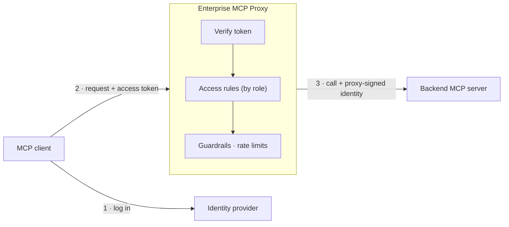

# Authentication and Authorization

How Enterprise MCP Proxy decides **who** is calling and **what** they may do. The README's [Authentication and Authorization](../README.md#authentication-and-authorization) section is the summary. For deploying with Okta behind an nginx ingress, see the [enterprise deployment guide](enterprise-deployment/enterprise-deployment.md). Code-level design notes for contributors are in [`architecture/auth.md`](architecture/auth.md).

## Contents

1. [The layers at a glance](#1-the-layers-at-a-glance)
2. [Client authentication](#2-client-authentication)
3. [How clients discover where to log in](#3-how-clients-discover-where-to-log-in)
4. [Authorization: roles and access rules](#4-authorization-roles-and-access-rules)
5. [The administrator role](#5-the-administrator-role)
6. [Beyond access rules: guardrails and rate limits](#6-beyond-access-rules-guardrails-and-rate-limits)
7. [Backend identity: what servers receive](#7-backend-identity-what-servers-receive)
8. [Network isolation](#8-network-isolation)
9. [Development and demo: the demo authorization server](#9-development-and-demo-the-demo-authorization-server)
10. [Production: using your identity provider](#10-production-using-your-identity-provider)
11. [Security properties and limits](#11-security-properties-and-limits)

---

## 1. The layers at a glance



| Layer | Question it answers | Where it's configured |
|---|---|---|
| **Client authentication** | Who is calling, and is the token genuine? | `auth` section; your identity provider |
| **Authorization** | May this role see and call this tool, prompt or resource? | `accessRules`, `roleMapping` |
| **Guardrails and rate limits** | Is *this particular call* acceptable right now? | `declarativeGuardrails`, `governanceOrchestration`, `rateLimiting` |
| **Backend identity** | What does the server learn about the caller? | `internalAuth` |
| **Network isolation** | Can anything bypass the proxy? | Kubernetes NetworkPolicies |

The proxy never logs users in itself. It follows the **OAuth 2.1** authorization flow that the MCP specification defines: the proxy is the OAuth *resource server*, and the **identity provider** (IdP) is the *authorization server*, Okta in production or the small demo server during development. Users log in at the IdP, and the client obtains an access token there through the authorization-code flow with PKCE. The proxy only **verifies** the access tokens the provider issues. This keeps passwords, multi-factor login and user management in the provider, where they belong.

## 2. Client authentication

Every request must carry an access token: `Authorization: Bearer <token>`. The proxy accepts a request only if the token:

- is a JWT signed with **RS256**, by a key the proxy trusts;
- has not expired (an `exp` claim is required);
- has the expected **issuer** (`iss`) and **audience** (`aud`), when these are configured.

Anything else is rejected with HTTP `401` before the request reaches any MCP logic.

### The `auth` configuration

| Field | Meaning |
|---|---|
| `jwksUrl` | The identity provider's JWKS endpoint, which publishes its signing keys. Keys are fetched and refreshed in the background, so the provider can rotate keys without restarting the proxy. |
| `publicKeyPath` | Alternative to `jwksUrl`: a fixed PEM public key. Used in tests. `jwksUrl` wins when both are set. |
| `issuer` | Required `iss` value. It's also advertised to clients as where to log in (see [section 3](#3-how-clients-discover-where-to-log-in)). |
| `audience` | Required `aud` value, so tokens issued for other applications are refused |
| `roleClaim` | Which token claim holds the user's roles, e.g. `groups` for Okta or `app_roles` for the demo server. Defaults to `role`. |
| `resourceUrl` | The proxy's public MCP URL, e.g. `https://mcp.acme.com/mcp`. Enables login discovery. |

Example (Okta):

```json
"auth": {
  "jwksUrl": "https://acme.okta.com/oauth2/default/v1/keys",
  "issuer": "https://acme.okta.com/oauth2/default",
  "audience": "api://mcp.acme.com",
  "roleClaim": "groups",
  "resourceUrl": "https://mcp.acme.com/mcp"
}
```

The `auth` section is read at startup only. Changing it means redeploying the proxy.

### Roles

The values of the `roleClaim` claim become the caller's **roles**. A claim can hold one role or a list. Identity providers name this claim differently (`groups`, `roles`, `app_roles`, …), so `roleClaim` maps whatever your provider emits onto the proxy's single notion of roles. Typically roles are your provider's groups, such as `support-agents` or `finance`.

## 3. How clients discover where to log in

A client that has never seen the proxy can find out where to log in on its own, as the [MCP authorization specification](https://modelcontextprotocol.io/specification/latest/basic/authorization) defines:

1. The client sends a request without a token. The proxy answers `401 Unauthorized` with:
   ```
   WWW-Authenticate: Bearer resource_metadata="https://mcp.acme.com/.well-known/oauth-protected-resource"
   ```
2. The client fetches that **protected-resource metadata** (RFC 9728). It names the identity provider:
   ```json
   {"resource": "https://mcp.acme.com/mcp", "authorization_servers": ["https://acme.okta.com/oauth2/default"]}
   ```
3. The client reads the provider's own metadata, logs the user in there (OAuth 2.1 authorization code with PKCE), and retries with the access token.

Notes:
- **Discovery is on when `resourceUrl` is set.** The metadata endpoint is public, because clients need it before they have a token. It's also served at the path-specific variant `/.well-known/oauth-protected-resource/mcp`, which spec-compliant clients try first.
- **The proxy works behind an ingress.** It builds the advertised URL from the `X-Forwarded-Proto` and `X-Forwarded-Host` headers, so behind a TLS-terminating ingress it advertises the public `https://` address.
- **A role-rule denial isn't a login problem.** A caller who is logged in but not allowed to use a tool gets an ordinary MCP error, not `401`. Logging in again wouldn't help.

## 4. Authorization: roles and access rules

Once a caller is authenticated, the **access rules** decide what their roles may use. Rules live in the `accessRules` section:

```json
"accessRules": {
  "clientAccessRules": [
    {
      "role": "admin",
      "allowed_tools": ["*"], "allowed_prompts": ["*"],
      "allowed_resources": ["*"], "allowed_resource_templates": ["*"]
    },
    {
      "role": "support-*",
      "allowed_tools": ["garden-customer-service.*", "proxy_utility.*"],
      "allowed_prompts": ["garden-customer-service.*"],
      "allowed_resources": [], "allowed_resource_templates": []
    }
  ]
}
```

How the rules apply:

- **Lists and calls are both filtered.**
  - Callers see only what they're allowed to use: `tools/list`, `prompts/list`, `resources/list` and `resources/templates/list` are filtered per caller.
  - A call to something outside the caller's rules is refused (`tools/call`, `prompts/get`, `resources/read`).
- **The rules are additive.** A caller with several roles gets everything any of their roles allows.
- **Names are namespaced** by server: tools and prompts as `<server>.<name>`, resources and templates as `<server>:<uri>`. Rules match these namespaced names.
- **Wildcards:**
  - In names, `*` matches any characters, including `/`, so `garden-online-store:*` matches every resource of that server.
  - In role patterns, `*` matches within a role name, e.g. `support-*`.
- **Nothing is allowed by default.** A role with no matching rule sees nothing.
- **Reading a resource through a template** also needs an `allowed_resources` pattern. `allowed_resource_templates` only controls whether the template is listed.

**Updating rules live.** Access rules change without a redeploy:

```sh
./scripts/cli.sh -username admin -password admin export-role-permissions > rules.json
# edit rules.json
./scripts/cli.sh -username admin -password admin update-role-permissions -file rules.json
```

Changes apply immediately on every proxy replica and survive restarts. Updates carry a version number, so two administrators can't silently overwrite each other's changes.

## 5. The administrator role

The proxy's own administration tools (`_admin.*`) are reserved for one **administrator role**. These tools export and update the access rules, guardrails, orchestration, discovery, event dictionary, rate limits and log level.

```json
"roleMapping": { "administrator": "admin" }
```

- **Required:** the proxy refuses to start without it.
- **Exact match:** the role name must match exactly, with no wildcards.
- **Separate from the access rules:** the `accessRules` can't grant or remove `_admin.*` access.
- **Fixed at startup:** it can't be changed through the admin tools, so no administrator can hand the gateway to another role, or lock every administrator out.

In Okta, map it to the group that should administer the gateway, e.g. `"administrator": "mcp-admins"`.

## 6. Beyond access rules: guardrails and rate limits

Access rules decide *whether* a role may use a tool at all. Two further checks decide whether **a specific call** is acceptable:

- **Declarative guardrails** check a call's arguments before it reaches the server, and its result before it reaches the client. Constraints can be scoped by role and time window, and can block, alert or log. See [Declarative Guardrails and Constraints](../README.md#declarative-guardrails-and-constraints).
- **Rate limits** cap how often each role may call each tool. See [Rate Limiting](../README.md#rate-limiting).

Both use the caller's verified identity and roles from the token.

## 7. Backend identity: what servers receive

**The client's token is never passed to backend servers.** That token proves who the caller is *to the proxy*. Forwarding it would hand every backend a live credential that might be accepted elsewhere. The MCP specification [explicitly forbids this "token passthrough"](https://modelcontextprotocol.io/specification/latest/basic/security_best_practices).

Instead, for every call it forwards, the proxy creates a **short-lived identity assertion**:
- **What it is:** a JWT the proxy signs itself.
- **What it states:** the caller's verified user ID (`sub`) and roles.
- **Lifetime:** 60 seconds by default.
- **How it's sent:** in the `X-Go-Proxy-Assertion` header.
- **Who it's for:** its audience is both `go-proxy-backend` and `go-proxy-backend/<server>`, so a server can insist on an assertion minted for itself.
- **What it isn't:** a credential. The proxy never accepts it back, so a backend can't use the identity it was told about to act as that user.

```json
"internalAuth": {
  "issuer": "go-proxy", "audience": "go-proxy-backend", "ttlSeconds": 60,
  "maxRelayHops": 3,
  "relay": { "garden-online-store": ["garden-business-ops.get_active_deals"] }
}
```

**The signing key** is generated at runtime and never stored in git or on disk outside the cluster. All proxy replicas share it through a Kubernetes Secret that the first replica creates. The public key is published at `/.well-known/jwks-internal.json`.

**When a backend needs credentials of its own.** Some backends require a key or an OAuth access token before they'll answer. For those, the gateway presents **its own** credentials: one per backend, the same for every user, never a client's token. They're stored in a Secret in the gateway's namespace, and assigned to a backend only by the gateway's own config (the discovery section's `k8sCredentials`, or a static entry's `credentialsSecret`), never by the backend itself. They can be a bearer token, any header (such as an API key), or OAuth 2.0 client credentials, which the gateway exchanges for an access token and renews. Each Secret also lists the hosts its credential may be sent to (the `mcp.io/allowed-hosts` annotation), and the gateway refuses to send it anywhere else, even if a server's address is changed or a backend redirects the request. Missing or invalid credentials fail closed. Details: [Backend credentials](../README.md#backend-credentials). Backends that need each user's own login (per-user OAuth) aren't supported.

**What backends can do with it:**
- **Nothing (most servers).** A server that only needs to know the call came through the proxy can ignore the header; network isolation already guarantees that.
- **Ownership checks.** A server that must apply per-user rules can verify the assertion against the proxy's public key. It then learns the caller's identity and roles without ever seeing the user's credential. For example: "users may read only *their own* orders".
- **Call back into the proxy as the user, if allowed to.** Only a server listed in `internalAuth.relay` gets a **relay token** and the proxy's own address. It can present that token back to the proxy to call another tool for the same user. A relayed call is checked like a direct call from the original user, and limited further:
  - only the targets listed for that server in `internalAuth.relay`;
  - never `_admin.*` tools;
  - no later expiry than the user's own credential, so a backend can't keep a user's identity alive;
  - at most `maxRelayHops` relays in a row (default 3).

  So **a relayed call can never gain more authority than the user had**. `internalAuth` is read once at startup, so the admin tools can't widen it.

The gateway's own `proxy_utility.call_tool` and `render_prompt` call back into the proxy with a separate loopback token that never leaves the proxy, so they keep the caller's full authority, up to `maxRelayHops` nested calls.

A request that carries an `Authorization` header is always judged by that header alone, even if the token is invalid. The proxy never falls back to a relay token in that case, so a forged one can't rescue a bad token.

## 8. Network isolation

The design assumes backends can be reached **only through the proxy**. The repository's Kubernetes NetworkPolicies enforce this:
- They deny all incoming traffic to backend pods in each namespace, except from the proxy's pods. In a namespace the deploy script doesn't own, the policy covers only the backend's own pods, so other workloads there are unaffected. A discovery namespace with no policy at all gets a warning when you deploy.
- They allow clients to reach the proxy itself.
- The demo authorization server accepts connections only from the proxy, the gardening servers that register demo users, the seed Job, and (on a local cluster) the `localhost:8102` load balancer.
- Optionally, `deploy.sh --egress-policies` also restricts what the proxy itself may connect to (see the enterprise deployment guide, §9.2).

NetworkPolicies need a network plugin (CNI) that enforces them, such as Calico, Cilium or most managed-cluster defaults. Without one, everything still works, but backends are no longer isolated. Verify enforcement in production.

## 9. Development and demo: the demo authorization server

For development and the demo, the project ships **`demo-authorization-server`**: a deliberately minimal OAuth 2.1 authorization server written for this project.

**Why a minimal server.** In production, the proxy is expected to use a leading identity provider such as Okta, Microsoft Entra ID or Auth0. For a laptop cluster and demos, the priorities are different: a **small footprint** (a few MB of memory and instant startup), no external accounts and no setup. A full identity-provider product would add hundreds of MB of memory and a slow start to every developer's cluster for no benefit. Because the proxy relies only on standard OAuth and JWT verification, switching to a production provider is a configuration change, not a code change.

**What it supports:**
- **The standard login flow:** authorization code with PKCE, refresh tokens, dynamic client registration (local addresses only), a signing-key JWKS endpoint and discovery metadata.
- **Roles:** emitted in an `app_roles` claim, which exercises the proxy's `roleClaim` mapping the same way a real provider's `groups` claim does.
- **User management:** a small admin API for users and roles.

**What it deliberately doesn't do:**
- **No real passwords:** every user's password equals the username (e.g. `admin`/`admin`).
- **Nothing persists:** users and keys are kept in memory, so a restart logs everyone out.
- **No high availability:** it runs as one replica.

**It's for development and demos only.**

It's deployed by `./scripts/deploy.sh --deploy-auth-server` (included in `--deploy-all`) and listens at `http://localhost:8102`.

### Logging in with the CLI

**Without a browser (demo server only).** The CLI sends the username and password directly, which suits scripts and quick checks:

```sh
./scripts/cli.sh -username admin -password admin list-tools
```

**With a browser (any provider).** Leave out `-username`/`-password`. The CLI prints a login URL; open it, log in, and the CLI continues:

```sh
./scripts/cli.sh list-tools
# Open this URL in a browser to log in:
#
#   http://localhost:8102/authorize?response_type=code&client_id=...
```

The browser flow is the same one a real provider uses. With Okta, add `-client-id` and `-scope` (see [section 10](#10-production-using-your-identity-provider)).

### Managing demo users and roles

```sh
echo '[{"username":"alice","roles":["finance","manager"]}]' > alice.json
./demo-authorization-server/scripts/manage-users.sh add alice.json
./demo-authorization-server/scripts/manage-users.sh list
./scripts/cli.sh -username alice -password alice list-tools    # sees what finance + manager allow
```

The built-in `admin` user (role `admin`) always exists. The gardening demo also adds its customers and staff as users automatically, with the roles the demo's access rules expect.

## 10. Production: using your identity provider

Any identity provider can be used if it:

- issues **JWT access tokens signed with RS256** and publishes its keys at a **JWKS** URL;
- can put the user's roles or groups in a token claim;
- supports the OAuth 2.1 authorization code flow with PKCE.

Okta, Microsoft Entra ID, Auth0 and Keycloak all fit. To switch:

1. Register an API / authorization server for the proxy in your provider, and add the users' groups to the access token.
2. Set the `auth` section: `jwksUrl`, `issuer`, `audience`, `roleClaim`, `resourceUrl`.
3. Set `roleMapping.administrator` to your admin group, and write `accessRules` for your groups.
4. Register client applications. Most enterprise providers don't allow anonymous dynamic registration, so clients use a pre-registered client ID.
5. Deploy with that config: `./scripts/deploy.sh --deploy-proxy ... --config ./proxy-server.<idp>.cfg`.

**Okta with an nginx ingress and HTTPS** is documented end to end, with a ready-made config template, in the [enterprise deployment guide](enterprise-deployment/enterprise-deployment.md):
- configuring Okta;
- writing the config;
- preparing TLS and DNS;
- deploying with `--ingress-host`;
- connecting clients, and verifying.

For the CLI against a real provider:

```sh
./scripts/cli.sh -endpoint https://mcp.acme.com/mcp \
  -auth-server https://acme.okta.com/oauth2/default \
  -client-id 0oa1b2c3d4 -redirect-port 8765 -scope "openid mcp.access" list-tools
```

Auth0 also needs `-audience` so it issues a JWT rather than an opaque token.

## 11. Security properties and limits

**Guaranteed by the proxy:**
- Every request is authenticated with a verified, unexpired token from the configured provider. There's no anonymous access to MCP methods.
- Each caller sees and calls only what their roles allow, and administration is limited to the administrator role.
- Client credentials never leave the proxy. Backends receive a 60-second, proxy-signed identity.
- Relayed calls never gain authority beyond the original caller's.

**Depends on the deployment:**
- **Network isolation of backends** depends on NetworkPolicy enforcement (see [section 8](#8-network-isolation)).
- **TLS** is provided by the ingress in an enterprise deployment. The local setup uses plain HTTP on `localhost`.
- **Per-user data ownership** inside a backend server is that server's job, using the identity assertion.

**Not provided:**
- **Logging users in**, multi-factor authentication and user lifecycle are the identity provider's job.
- **Token revocation before expiry** depends on the provider's token lifetimes. The proxy validates signature and expiry, and doesn't check revocation lists.
